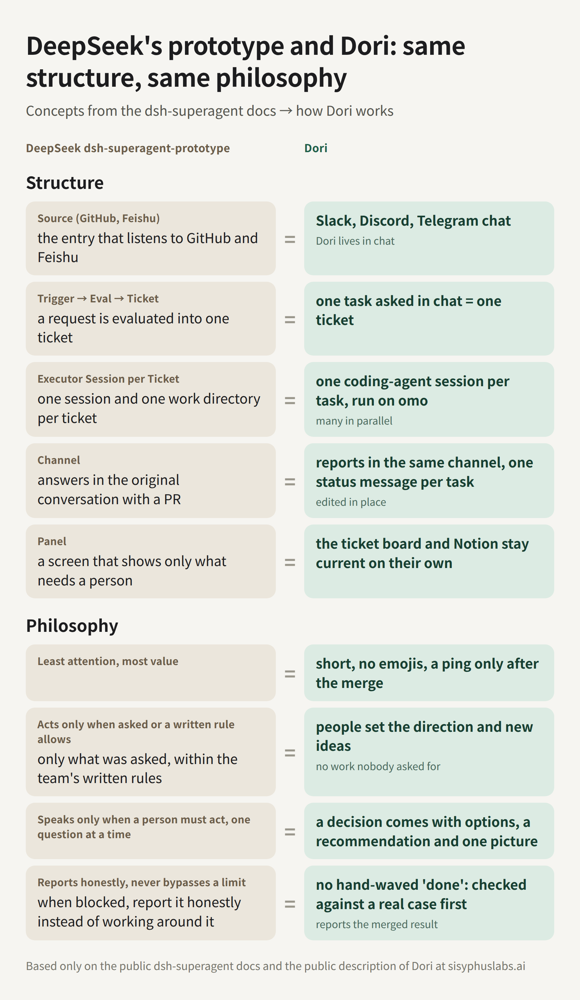

[English](README.md) · [简体中文](README.zh-CN.md) · **日本語** · [한국어](README.ko.md)

<p align="center">
  
</p>

# win-dori

> **win-dori は [sisyphuslabs/dori-superagent](https://github.com/sisyphuslabs/dori-superagent) の Windows 移植版です。** 上流のコミット [181df3e](https://github.com/sisyphuslabs/dori-superagent/commit/181df3e) をもとにしており、挙動と既定値は上流のままです。ここで加えたのは Windows に必要な部分です。PowerShell でのインストール、pane のシェル判定、自動起動と Slack リスナーを含む Windows プロファイルです。Dori モードとハーネスの功績は上流の作者にあり、Windows 部分のバグは私たちの責任です。ライセンスには元の著作権表示をそのまま残しています。

Dori モードは、コーディングエージェントのセッションひとつを常駐型のメッセンジャーエージェントに変えます。あなたが話す相手は Slack、Telegram、Discord のどれかのボットひとつだけ。Dori は仕事ごとに herdr のタブでエージェントセッションを立ち上げて任せ、自分が立ち上げたセッションをすべて覚えておき、仕事が本当に終わったときだけ閉じます。PR がマージされ、issue が閉じ、バージョンが公開されたあとです。

中身はスキル(`skills/dori-mode/SKILL.md` と references)と、bun + TypeScript の小さな CLI `dori` です。実験段階なので、粗いところがあります。

## インストール

### Windows

PowerShell で、どのフォルダからでも 1 行で入ります。git がなければ winget で入れ、bun と herdr がなければ公式インストーラーで入れます(`DORI_NO_DEPS=1` で無効にできます)。メッセンジャー(Slack、Telegram、Discord から選択)や自動起動などの Windows プロファイルは[英語の README](README.md#windows-profile)を見てください。

```powershell
irm https://raw.githubusercontent.com/useonmn/win-dori/main/install.ps1 | iex
```

どこで実行しても `%USERPROFILE%\.dori\src` にインストールします。`install.sh` が `~/.dori/src` を使うのと同じなので、先に clone したりフォルダへ移動したりする必要はありません。もう一度実行するとその複製を更新します。スキルは `%USERPROFILE%\.agents\skills\dori-mode` にディレクトリジャンクションとしてリンクするので、管理者権限も開発者モードもいりません。`bun install` と `bun link` を実行し、bun のグローバル bin フォルダがユーザー PATH になければ追加します。設定の例は `%USERPROFILE%\.dori\config.json` にコピーします。場所は `DORI_SRC`、`SKILLS_DIR`、`DORI_HOME` で、リポジトリは `DORI_REPO` で変えられます。PATH の変更を反映するため、ターミナルを開き直してください。チェックアウトがすでにあれば、`.\install.ps1`(`cmd.exe` では `install.cmd`)でも同じです。 再実行時の `git pull` を飛ばすには、`install.sh` と同じく `DORI_NO_PULL=1`（`true`、`yes` も可）を使います。PowerShell では `$env:DORI_NO_PULL='1'` です。

### macOS と Linux

```sh
curl -fsSL https://raw.githubusercontent.com/useonmn/win-dori/main/install.sh | bash
```

リポジトリを `~/.dori/src` に取得し、スキルを `~/.agents/skills/dori-mode` にリンクし、`bun link` で `dori` を PATH に通し、設定の例を `~/.dori/config.json` にコピーします。エージェントが別の場所からスキルを読む場合は `SKILLS_DIR` を指定してください。

あとは herdr の中でエージェントを開いて「Dori mode」と言うだけです。

## スーパーエージェント・ハーネス

このリポジトリのルートには、[sisyphuslabs/dori-superagent](https://github.com/sisyphuslabs/dori-superagent) のハーネスを移植したものも入っています。Dori モードとは別の、より小さな仕組みで、挙動と既定値は上流のままです。この節の文章は上流の README から移したものなので、「私たち」は上流のチームを指します。

人と会話するのは lead セッション一つだけです。タスクは一つずつ lane として走ります。lane は専用の herdr タブに立てた omo セッションで、文書化された brief（指示書）から始まり、エビデンス付きの READY で終わります。duty ループは黙り込んだ lane を催促し、lead にエスカレーションし、忙しいペイン宛てのメッセージは読める状態になるまで預かります。マージはゲートを通ります。ゲートが要求するのは、現在の head SHA に対する CLEAR のレビュー記録（receipt）と、グリーンのチェックです。

### なぜ作ったか

DeepSeek が [dsh-superagent-prototype](https://github.com/deepseek-ai/dsh-superagent-prototype) を公開しました（最初のコミットは 2026-10-31）。その約 1 日後に記事 "Exploring Super-agent Design: Towards a More Autonomous Agent System" が出ています。設計は、人とだけ会話して仕事を振り分ける長命の Router セッション、チケットごとに隔離された Worker セッション、ターン単位でまとめて届くイベントトリガー、そして watchdog からなります。README には研究プロトタイプと書かれ、掲げる思想は "take as little human attention as possible, and give as much value as possible"（人の注意は最小限に、価値は最大限に）です。

同じ形のものを、私たちは約半年、公開の場で動かし続けてきました。

- 2026-04-18: omo にチームモードが入りました。ターミナルのペインごとにエージェントセッション一つ、それぞれに worktree 一つです（[f1268c0](https://github.com/code-yeongyu/oh-my-openagent/commit/f1268c0)、[e303fee](https://github.com/code-yeongyu/oh-my-openagent/commit/e303fee)）。
- 2026-05-06: omo の README に Dori の名前が載りました（[#3807](https://github.com/code-yeongyu/oh-my-openagent/pull/3807)）。
- 2026-10-07: このリポジトリが Dori モードを `omo-dori-mode-experimental` として公開しました（[ce53e4d](https://github.com/sisyphuslabs/dori-superagent/commit/ce53e4d)）。一つのエージェントが仕事ごとに herdr タブへ専用のエージェントセッションを立てて任せ、仕事が終わってから初めて閉じます。git の履歴は公開されています。
- 2026-10-31: DeepSeek のプロトタイプに最初のコミット。
- 2026-11-01 ごろ: DeepSeek の記事。

これが私たちの日々の働き方です。omo のスターは 7 万を超えています。2026-10-03 から 2026-11-02 までの 31 日間で、[作者の GitHub コントリビューションカレンダー](https://github.com/code-yeongyu)には 38,656 件のコントリビューションが記録されています。1 日平均で約 1,250 件、ピークは 2026-10-16 の 2,227 件と 2026-10-29 の 2,001 件です。多い日には 1 日 2,000 件前後に達し、これをこのセットアップのフル版で出しています。

このリポジトリのルートにあるハーネスは、その最小版です。herdr と omo だけで動く部分で、ほかには何も付いていません。

### 同じ構造、同じ思想

DeepSeek のプロトタイプのドキュメントと Dori は、構造でも[思想のドキュメント](https://github.com/deepseek-ai/dsh-superagent-prototype/blob/main/docs/000-philosophy.md)でも、概念が一つずつ対応します。



#### 構造

| DeepSeek dsh-superagent | Dori |
|---|---|
| Source（GitHub、Feishu） | Dori の居場所はチャットです。Slack、Discord、Telegram |
| Trigger → Eval → Ticket | チャットで頼まれた一つのタスクが、一つのチケットになります |
| チケットごとの Executor セッション（セッション一つ、作業ディレクトリ一つ） | タスクごとにコーディングエージェントのセッション一つ。omo で動き、多数が並列に走ります |
| Channel（元の会話の中で答える。たとえば PR で） | 同じチャンネルに報告します。タスクごとにステータスメッセージは一通で、それをその場で編集し続けます |
| Panel（人の対応が要るものだけを見せる） | チケットボードと Notion は自動で最新に保たれます |

#### 思想

| DeepSeek dsh-superagent | Dori |
|---|---|
| 人の注意は最小限に、価値は最大限に | 短いメッセージ、絵文字なし、ping はマージ後に一度だけ |
| 頼まれたとき、または文書化されたチームのルールが許すときだけ動く | 方向性と新しいアイデアは人が出します。誰も頼んでいない仕事を Dori が始めることはありません |
| 人が動かなければならないときだけ話す。質問は一度に一つ | 判断を求めるときは、選択肢、自分の推奨、図を一枚添えます |
| 正直に報告し、ブロックを迂回しない | 証明なしの「done」はありません。実際のケースで検証し、マージ済みの結果を報告します |

Dori の列は、私たちの本番の Dori と Dori モード（`skills/dori-mode`）です。このリポジトリのルートにあるハーネスは、そのうち lane、inbox、duty、マージゲートの部分を herdr + omo の上に実装したものです。

### アーキテクチャ


役割は三つで、それぞれが herdr のペイン内で動く omo セッションです。herdr がワークスペース、タブ、ペインを提供し、ペインの中の omo をエージェントとして認識して、その状態（idle、working、blocked、done）を CLI 経由で返します。ハーネスはペインに何かする前に、必ずこの状態を読みます。

lead は人と会話する唯一のセッションです。依頼を brief に落とし込み、`dori-harness start` で lane を開き、lane からの報告を読み、マージします。

lane は専用の herdr タブに立てた omo セッション一つで、brief 一つの末尾に lane ルール（`prompts/lane-footer.md`）を付けた状態で起動します。途中経過は `dori-harness report` で報告し、`dori-harness ready` で終えます。`dori-harness ready` はエビデンスのリンクなしでは送信を拒否します。

duty ループは `dori-harness duty --interval 60` です。duty 用の omo セッションの隣のペインで動く、ただのプロセスです。tick ごとに、idle になったペインへ溜まったメッセージを流し込み、黙っている lane を催促し、lead にエスカレーションし、ペインが消えた lane を lost 扱いにします。緊急停止は `dori-harness duty stop --text "理由"` です。`dori-harness duty resume` までは tick ごとに `DUTY stopped: <理由>` を出力するだけで、duty の仕事はすべて飛ばします（流し込み、催促、エスカレーション、duty のカウントなし）。溜まったメッセージは inbox で待ちます。`dori-harness duty status` は止まっているかどうかとその理由を表示します。

状態は `~/.dori`（または `$DORI_HOME`）配下の JSON です。`lanes/`、`inbox/`、`briefs/`、`receipts/`、それに 1 時間ループが使う `backlog/` と `loop/`、duty ループの停止ファイルを置く `duty/`。エージェントのセッションを除けば、ハーネスが増やす常駐プロセスは duty ループと 1 時間ループの 2 つだけで、ランタイム依存は Bun だけです。


`dori-harness start <key> --brief FILE` は、brief と lane ルールを `~/.dori/briefs/<key>.md` に書き、タブを開いて `omo 'Read your brief at <path> and execute it. Your lane key is <key>.'` を実行し、lane を `working` として記録し、lead に `[START <key>]` を送ります。以降、lane は `[REPORT <key>]` で報告し（自分のペインの外でブロックされているときは `[REPORT <key> WAITING]`）、エビデンスのリンクを添えた `[READY <key>]` で終えます。lead はエビデンスを確認し、PR があれば `dori-harness review` と `dori-harness merge` を実行し、`dori-harness done <key>` で lane を閉じます。idle のままの lane は 10 分と 20 分で催促され、40 分で lead にエスカレーションされます（`[ESCALATE <key>]`）。READY の前にペインが消えた lane は `[LOST <key>]` として報告されます。

### DeepSeek の super-agent との対応

| DeepSeek super-agent | ハーネス | このリポジトリでは |
|---|---|---|
| Router セッション: 人と会話し、仕事を振り分ける | LEAD セッション: 人と会話する唯一のセッション。lane を開き、マージする | `prompts/lead.md`、`src/cli.ts` の `up()` |
| Worker セッション、チケットごとに一つ | LANE: タスクごとに omo セッション一つ。専用の herdr タブと専用の brief を持つ | `src/harness.ts` の `startLane()`、`prompts/lane-footer.md` |
| Ticket + Mandate | brief ファイル + lane ルールのフッター、そしてエビデンス必須の READY | `~/.dori/briefs/<key>.md`、`src/harness.ts` の `ready()` |
| トリガーのバッチ化: イベントをターン単位でまとめる | ペインの inbox: 忙しいペイン宛てのメッセージはキューに入り、idle になった時点で一括で届く | `src/harness.ts` の `send()`、`flushInbox()`。`src/store.ts` の `inbox/` |
| Watchdog | DUTY ループ: inbox を流し、10/20 分で催促、40 分でエスカレーション、消えたペインを検知 | `src/harness.ts` の `dutyTick()`、`prompts/duty.md`、`prompts/nudge.md` |
| Admission matrix、`maxWorkers`（デフォルト 3） | 1 時間ループの予算: 開いている lane は `--max-lanes`（デフォルト 3）まで、1 回 `--max-starts`（デフォルト 2）まで、負荷の高いホストでは始めない | `src/loop.ts` の `loopTick()` |
| プロトタイプにはない | ゲート付きマージ: head SHA に厳密に一致する CLEAR の receipt と、グリーンのチェック。空のチェック一覧はグリーン扱いしない | `src/harness.ts` の `review()`、`mergeGate()`、`prompts/review.md`、`src/store.ts` の `receipts/` |
| プロトタイプにはない | 窓口一本化のルール: lane と duty は人に話しかけない | `prompts/lead.md`、`prompts/duty.md`、`prompts/lane-footer.md` |
| プロトタイプにはない | 回答の全文台帳: lane ごとの最終回答、エビデンスのリンク、ログをディスクに保存 | `src/store.ts` の `Lane.final`、`Lane.log` |

### クイックスタート

Bun 1.3 以上、herdr、omo、GitHub CLI の `gh`（PR の head SHA の取得、チェックの確認、マージに使います）が必要です。

```sh
git clone https://github.com/useonmn/win-dori
cd win-dori
bun install
bun link   # `dori-harness` を PATH に載せます。以下の `dori-harness` は `bun src/cli.ts` と書いても同じです
```

インストーラーを使った場合、`dori-harness` はすでにリンクされています。

herdr を起動し、シェルから:

```sh
dori-harness up
# UP lead=w1:p1 duty=w1:p2 loop=w1:p3 hourly=w1:p4 home=~/.dori
```

これで `dori` という名前の herdr ワークスペースが開き、lead ペイン（システムプロンプトに `prompts/lead.md` を追記した omo）、duty ペイン（`prompts/duty.md` を追記した omo）、その下に duty ループ、さらにその下に 1 時間ループが立ちます。話しかける相手は lead ペインです。lead は brief（目標、入力、成果物、終了条件、制約。[`examples/brief.md`](examples/brief.md) を参照）を書いて自分で lane を開きます。同じことはシェルからもできます。

```sh
dori-harness start fix-flaky-login --brief examples/brief.md
# STARTED fix-flaky-login pane=w1:p5 brief=~/.dori/briefs/fix-flaky-login.md
dori-harness status
# lead=w1:p1 duty=w1:p2 home=~/.dori
# fix-flaky-login          working  w1:p5    active 0m ago  start: examples/brief.md
```

lane の key は `^[a-z][a-z0-9-]{1,40}$` に一致する必要があり、すでに開いている key は拒否されます。

lane の中では、omo が lane ルールから渡されたコマンドで報告し、仕事を終えます。

```sh
dori-harness report fix-flaky-login --text 'reproduced: 1 failure in 20 runs, shared session fixture'
dori-harness report fix-flaky-login --status waiting --text 'WAITING: checks on owner/repo#12'
dori-harness ready fix-flaky-login --text 'root cause fixed in owner/repo#12, checks green' --evidence https://github.com/owner/repo/pull/12
```

`[READY fix-flaky-login]` を受け取った lead は:

```sh
dori-harness review owner/repo#12            # fresh omo reviewer pinned to the head SHA; writes a receipt; exit 0 on CLEAR
dori-harness merge owner/repo#12 --dry-run   # MERGE_OK ... (dry run), or MERGE_REFUSED <why> with exit 2
dori-harness merge owner/repo#12             # gh pr merge --squash --match-head-commit <sha>
dori-harness done fix-flaky-login            # closes the lane's pane; only a READY lane can be closed
```

`dori-harness send <lead|duty|key|pane> --text '...'` はペインにメッセージを届け、ペインが忙しければキューに入れます。`dori-harness role <lead|duty> [PANE]` は、`dori-harness up` を使わなかったときにペインを手動で登録します。`--text` を省くと stdin からメッセージを読みます。エージェントに見せるコマンドは `src/cli.ts` のフルパスと `DORI_HOME` を埋め込んだ形でレンダリングされるので、エージェント側の PATH に `dori-harness` は要りません。環境変数: `DORI_HOME`（状態ディレクトリ、デフォルト `~/.dori`）、`DORI_AGENT_CMD`（デフォルト `omo`）、`DORI_HERDR_SESSION`（名前付きの herdr セッション）、`DORI_CMD`（エージェントに dori をどう呼ばせるか）。

### ハーネスが強制すること

窓口は一つです。人と会話するセッションは lead だけです（`prompts/lead.md`）。lane ルールは、人に伝えるべき事実をすべて lead に送るよう定めています（`prompts/lane-footer.md` のルール 3）。duty セッションはマージせず、人にも話しかけません（`prompts/duty.md`）。lane の動きはすべてプロンプトとして lead ペインに届きます。`[START]`、`[REPORT]`、`[READY]`、`[LOST]`、`[ESCALATE]`。

READY にはエビデンスが要ります。`dori-harness ready` は、`--evidence` のリンクが一つもないか、最終回答のテキストがなければ拒否します（`src/harness.ts` の `ready()`）。テキストとリンクは lane レコードの `final` に保存され、`dori-harness done` は `ready` でない lane を拒否します。記録された回答なしに閉じる lane はありません。

忙しいペインには割り込みません。`dori-harness send` はまず herdr にペインのエージェント状態を問い合わせます。`idle` か `done` ならその場で届け、それ以外は `~/.dori/inbox/` のキューに入れて `QUEUED` と表示します。手前でエージェントが動いていないペイン（エージェントが終了してシェル（pwsh、powershell、cmd、bash）がプロンプトに残った状態。macOS と Linux では Ctrl+Z で止まった状態も含む）には決して入力しません。シェルに入力したテキストはコマンドとして実行されるからです。そのペイン宛てのメッセージはキューに残り、エージェントが戻るまで duty ループが `inbox-held` を表示します。素のシェルにあえて入力するときは、運用者が `--to-shell` を付けます。その一通だけに効き、キューにあるメッセージには効きません。Windows では herdr の process-info がペイン自身のシェルしか示さないため、ハーネスは herdr のエージェント状態で判断し、`--to-shell` は一行ごとに Enter を押して入力します。duty ループはペインが idle になった時点でキューをまとめて一通のメッセージとして届けます。その先頭は "N messages arrived while you were busy" です（`src/harness.ts` の `send()` と `flushInbox()`）。`dori-harness done` も同じ流儀で待ちます。herdr が working または blocked と報告するペインは閉じません。

10 分、20 分、40 分で催促します。`src/harness.ts` の `NUDGE_MINUTES = [10, 20, 40]` です。10 分間報告がなく、ペインも working でない lane は、自分のペインに `prompts/nudge.md` を受け取ります。20 分でもう一度。40 分で duty ループは催促をやめ、lead に `[ESCALATE <key>]` を送ります。`working` のペインはアイドル時間をリセットし、`--status waiting` で報告した lane やペインが `blocked` の lane には触れません。新しい報告があれば催促の回数は 0 に戻り、ペインが消えれば `[LOST <key>]` として報告されます。

マージには、head SHA に厳密に一致する CLEAR の receipt と、グリーンのチェックが要ります。`dori-harness merge` は `gh` で PR の head SHA を読み、その SHA に対する verdict が `CLEAR` の receipt が `~/.dori/receipts/` にあることを要求します。receipt を書くのは `dori-harness review` だけです。`dori-harness review` は、その SHA に固定した `prompts/review.md` で新しい非対話モードの omo（`omo -p --no-session`、必要なら `--model` も）を走らせ、レビュアーが `VERDICT:` 行を出さなければ receipt を書きません。次に `gh pr checks` がチェックを一つ以上返し、すべてのチェックが `pass` か `skipping` で、そのうち一つ以上が `pass` でなければなりません。空のチェック一覧は "an empty check list is never green" と言って拒否します。マージ自体は `gh pr merge --squash --match-head-commit <sha>` です。レビュー後に push すると head SHA が変わり、receipt が一致しなくなるのでマージは拒否されます（`src/harness.ts` の `review()` と `mergeGate()`）。

### 1 時間ループ

`dori-harness up` は 4 つ目のペインで `dori-harness loop` も起動します。1 時間ごとにハーネスの状態を実際と突き合わせ、誰の判断も要らない次の仕事を自分で始めます。次に何をやるかを lead が覚えておく必要はありません。設計の全体は [`docs/hourly-loop.md`](docs/hourly-loop.md) にあります。

仕事は `~/.dori/backlog/` のバックログに、1 項目につき brief 1 つで並びます。lead が追加するか、ラベル付きの開いている GitHub issue を取り込みます。

```sh
dori-harness backlog add search-index --brief briefs/search.md --priority 2
dori-harness backlog add new-billing --brief briefs/billing.md --decision 'シート課金かワークスペース課金か?'
dori-harness backlog import owner/repo --label dori     # p1..p9 ラベルは優先度、needs-decision ラベルは質問
dori-harness backlog list
```

ループはまず関門を見ます。止められているとき、別のループがロックを持っているとき、前回の実行から間隔（デフォルト 1 時間。`--force` ならこの確認を飛ばします）がたっていないときは何もしません。関門を通った実行は、次の 5 つをこの順番で行います。

1. 同期。lane が終わった項目、READY の PR がマージされた項目は done になります。lane が lost になった項目はキューに戻り、2 回失うと質問に変わります。取り込んだ issue が閉じられた項目は外れます。
2. 取りこぼしの点検。3 時間報告のない lane、READY のまま 2 時間誰も閉じていない lane、ペインが消えた lane を拾います。
3. 次の仕事を引く。質問の付いていない開いた項目を、優先度、次に古い順で始めます。開始に 2 回失敗した項目は質問に変わるので、後ろの項目を止めません。開いている lane は `--max-lanes`（デフォルト 3）まで、1 回あたり `--max-starts`（デフォルト 2）までです。1 分間のロードがコア数（または `--max-load`）を超えているか、使えるメモリが 10% を切っていると（macOS では空きページだけだと常に 0 近くになるので、カーネルの利用可能メモリの値を使います）何も始めません。
4. 尋ねる。開いている質問は `[DECIDE <id>]` として lead に 1 回届き、6 時間後に 1 回だけ再送されます。lead が人に尋ね、答えを `dori-harness backlog decide <id> --text '...'` で記録するか（答えは項目の brief の末尾に追記されます）、`dori-harness backlog drop <id>` で外します。
5. 報告。開いている lane の数と上限、バックログの件数、ホストのロードと空きメモリ、見つけたことを `[LOOP ...]` メッセージ 1 つで lead に送ります。関門を通った実行は `~/.dori/loop/runs/` にも記録が残ります。

自分の状態ファイル（バックログ項目、実行記録、ロック）を除けば、ループがするのは lane を開くこととメッセージを送ることだけです。マージ、プッシュ、ペインを閉じることはせず、開いている lane の記録も書き換えません（lost になった項目をやり直すときは同じ key で新しい lane を開きます）。`gh` は読むだけです。緊急停止は `dori-harness loop stop --text "理由"` です。`dori-harness loop resume` までは毎回何もしません。ロックと最終実行の記録があるので、ループが 2 つあっても同じ時間帯を 2 回走ることはなく、cron から `dori-harness loop --once` を併用しても安全です。`dori-harness loop status` は最後の実行を表示します。

### テレメトリ

ハーネスはデフォルトで有効なテレメトリとして、omo と同じやり方で匿名の利用回数を送ります。OTLP/HTTP の JSON ログを、omo のコレクター `https://t.omo.dev` に送ります。識別子は `~/.dori/telemetry.json` に置いたランダムなインストール id で、送るのはその sha256 だけです。初回の送信時に、コレクターがそのハッシュからインストールごとの ingest key を発行します（`POST /v1/register`）。key は `~/.dori/telemetry.json` にキャッシュし、コレクターが 401 を返したら発行し直します。コードには共有の key は入っていません。初回の実行では一行の通知を表示します。`DORI_TELEMETRY=0` で止まります（`DO_NOT_TRACK=1` でも止まります）。`DORI_TELEMETRY_ENDPOINT` でコレクターの URL を差し替えられます。

| イベント | いつ | フィールド |
|---|---|---|
| `dori.installed` | 初回の実行 | なし |
| `dori.daily_active` | どの `dori-harness` コマンドでも、UTC の一日に一回 | `day_utc` |
| `dori.lane_started` | `dori-harness start` | `open_lanes` |
| `dori.lane_ready` | `dori-harness ready` | `evidence_count`、`lane_minutes` |
| `dori.review_completed` | `dori-harness review` | `verdict`: `CLEAR` または `BLOCK` |
| `dori.merge_decided` | `--dry-run` なしの `dori-harness merge` | `outcome`: `merged`、`no_receipt`、`review_block`、`no_checks`、`checks_red`、`checks_all_skipped` |
| `dori.duty_summary` | duty ループから一時間に最大一回 | `ticks`、`flushed`、`nudges`、`escalations`、`lost` |

日次、週次、月次のアクティブ数は `dori.daily_active` から数えます。アクティブ数はインストール単位で数えるので、同時に起動した二つの実行がまれに二回送っても数は変わりません。どのレコードにもリソースフィールドが付きます。サービス名とバージョン、インストールのハッシュ、CI フラグ、OS の種類（`darwin`、`linux`、`windows` のいずれか。それ以外の OS では何も送りません）とバージョン、CPU アーキテクチャです。パス、リポジトリ名、PR 番号、lane の key、brief、メッセージ、その他のテキストは一切送りません。送信はバックグラウンドで行い、リクエストごとのタイムアウトは 2 秒です。コマンドは終了前に最大 2 秒だけ待ち、テレメトリが失敗してもコマンドは失敗しません。

### これは何ではないか

最小の実験です。ハーネスは Bun 上の TypeScript 約 2,000 行でランタイム依存はゼロ、私たちの本番スタックではありません。意図して外したもの: マシン間のメッシュ、heavy-slot のスケジューリング、チャットとチケットトラッカーのブリッジ、テストスイート全体に対する receipt。ここにあるのは herdr と omo だけで動く部分です。役割、lane、inbox、duty ループ、1 時間ループとバックログ、レビューとマージのゲート。`skills/dori-mode` の Dori モードは、独自のメッセンジャー部品、ホストガード、heavy-slot ランナーを持つ別の CLI で、ハーネスはそこから何も import しません。

### Windows のペインについて

ハーネスはペインにコマンド行を打ち込んで動かすので、新しいペインごとに実際のシェルを調べ、それに合わせて引用します。pwsh、PowerShell 5.1、cmd、Git Bash のどれでも動きます。`DORI_PANE_SHELL`(`posix`、`pwsh`、`powershell`、`cmd`)を設定すると、この判定より優先されます。cmd のペインでは、エージェントの起動行を PowerShell 5.1 が解釈します。`.ps1` のシムを使うなら実行ポリシーに注意してください。Windows のロードは 1 分平均がないので、CPU 使用率にコア数を掛けてプロセッサキューを足した値を使います。`dori-harness loop --once` を定期実行するときは cron の代わりにタスクスケジューラを使えます。インストール先のパスに `$`、バッククォート、`%`、`"` が含まれるときは `DORI_CMD` を設定してください。

### 状態の置き場所とコマンド名

状態は `DORI_HOME`(デフォルト `~/.dori`)の下に置きます。Dori モードは同じフォルダの `state/` と `config.json` を使うので、互いに上書きしません。分けたいときは `DORI_HOME` を別のフォルダにしてください。上流ではどちらの CLI も `dori` ですが、このリポジトリでは `dori` が Dori モード、`dori-harness` がハーネスです。ハーネスが立てたエージェントは `src/cli.ts` のフルパスで自分を呼ぶので、PATH の状態には左右されません。

## 必要なもの

- [bun](https://bun.sh) 1.3 以上と git
- [herdr](https://herdr.dev):レーンが動くターミナルマルチプレクサ。Windows では `powershell -ExecutionPolicy Bypass -c "irm https://herdr.dev/install.ps1 | iex"` で入れます。
- スキルを読み込むコーディングエージェント([OmO](https://github.com/code-yeongyu/oh-my-openagent) 向けに作っていますが、起動コマンドは設定で変えられます)
- PR のマージと issue のクローズを確認する `gh`(GitHub CLI)、公開バージョンを確認する `npm`
- ボット本体のための [agent-messenger](https://github.com/agent-messenger/agent-messenger)

ホスト監視は macOS と Windows で負荷、メモリ、スワップ、ディスクをすべて読みます。Windows では `powershell.exe` を 1 回呼んで読みます。このときの負荷は CPU 使用率に CPU 数を掛けてプロセッサキューを足した値で、約 1 秒の平均なので、Unix の 1 分平均より大きく揺れます。Linux では負荷とディスクだけを見て、メモリとスワップは不明として扱います。

## Dori の名前

Dori は最初に、自分を何と呼べばいいかを聞いてきます。「Dori」のままでもいいし、ShipDori や WorkDori のように Dori で終わる名前でも構いません。複数動かすときに見分けやすくなります。決めた名前はボット名、メッセージの署名、モード名にそのまま使われ、次からは「ShipDori mode」の一言で戻せます。

## Slack で使うとき

Slack を選ぶと、Dori はもうひとつ質問して答えを待ちます。

- **ユーザートークン**:ワークスペースの本物のメンバーとして動きます。有料の席がひとつ必要で、その費用はあなたが払います。そのメンバーが見られるものはすべて読め、緑のオンライン表示も保てます。
- **ボットトークン**:Slack アプリとして動きます。席の費用はかかりませんが、招待されたチャンネルと、アプリに与えた権限の範囲しか見えません。

## Dori の話し方

Dori はあなたの話し方に合わせます。短く、くだけた調子で、小文字で書けば、同じように返します。どの言語でも絵文字は使いません。伝えることがいくつかあるときは、長い文章ひとつではなく短いメッセージに分けて送り、それぞれ用意できた時点ですぐに送ります。わざと間をあけることはしません。刻々と変わる進捗だけは例外で、ひとつのメッセージをその場で書き換えていきます。

## 設定

設定はすべて `~/.dori/config.json` にあり、どの項目も省略できます。たいてい決めておくのは次の項目です。

| 項目 | 意味 |
|---|---|
| `leadPane` | Dori 自身の herdr pane(`herdr pane current`)。レーンの報告はここに届きます。 |
| `laneWorkspace` | 新しいレーンのタブを開く herdr workspace |
| `defaultCwd` | レーンが始まるディレクトリで、レーンが worktree を作るリポジトリ |
| `agentCommand` | エージェントの起動コマンド。`{model}` と `{prompt}` を含む argv のリスト |
| `paneShell` | レーンの pane のシェル:`auto`(既定)、`posix`、`pwsh`、`powershell`、`cmd`。`auto` は Windows 以外では posix です。Windows では herdr に pane のシェルを尋ね、わからなければ `pwsh` とみなします。pane のシェルがいつも同じなら明示してください。 |
| `hooks.threadReply`, `hooks.threadDone` | メッセンジャー CLI を `{thread}` と `{text}` を含む argv のリストで。レーンの進捗投稿と完了表示に使います。 |

残り(時間、しきい値、heavy スロット数)は既定値で十分です。全項目の表は [`references/scripts.md`](skills/dori-mode/references/scripts.md) にあります。環境変数 `DORI_CONFIG`、`DORI_STATE_DIR`、`DORI_LEAD_PANE` はファイルより優先されます。

## オンボーディング

最初のセットアップで、Dori は何かを読む前にまず許可を求めます。使っているツール、何をなぜやっているのか、あなたと会社がどんなところかを知ってもいいか、と。許可があったときだけ、ツールをひとつずつ見ていきます。ツールごとに、どの連携を使い、それが何を読むのかを説明してから個別に聞きます。たとえば「Gmail とカレンダーを読む CLI で、予定とメールを見守ってもいいですか?」という具合です。断られたツールは飛ばし、断られたことも覚えておきます。

全体を通して読むだけです。わかったことはその都度メモリに書き、最後に、わかったことと足りないところを短くまとめて伝えます。手順の詳細は [`references/onboarding.md`](skills/dori-mode/references/onboarding.md) にあります。

## 依頼の振り分け

メッセージごとの扱いは Dori が自分で決めます。

- 質問、状況確認、調べもの、数回のツール呼び出しで済む小さな修正は、新しいセッションを開かずにその場で片づけます。
- PR で終わるコード作業、何段階もある仕事、長くかかる仕事や並列にできる仕事はレーンを開きます。そのリポジトリを担当していて手が空いているレーンがあれば、新しく開かずにそちらへ渡します。
- メモリ、ディスク、pane 数に余裕がないとき(`dori can-launch` が HOLD)は何も開きません。仕事を待ち行列に入れ、理由を伝えます。
- 新しい仕事は新しいスレッドで始めます。続きの話は元のスレッドに戻し、レーンが閉じていれば記録してあるセッションを開き直します。ちょっとした質問は、聞かれたその場で答えます。

## セッションレジストリ

レーンごとに `~/.dori/state/lanes/` の下に JSON ファイルがひとつできます。メッセンジャーのスレッドと herdr の pane、pane とエージェントのセッション id を結びつけ、状態(`working`、`done-claimed`、`verified-done`、`not-done`、`closed`)とその変化の履歴を残します。

`dori sync` はこの記録を実際に動いている pane と突き合わせて、ずれを教えてくれます。消えた pane、変わったセッション id、完了を証明する手段がないレーンなどです。何も削除しません。`--write` を付けると、見つけたセッション id を保存します。

## 5 分の完了フロー

レーンが完了を申告します。

```sh
dori claim-done fix-login --evidence "merged acme/app#412 (a1b2c3d)"
```

Dori には `LANE_DONE_CLAIMED` が届き、レーンには 5 分後に閉じると伝わります。その間に異議を出せます。

```sh
dori object-done fix-login --reason "changelog の項目が抜けている"
```

理由はそのままレーンに届き、レーンは直してからもう一度申告します。誰も異議を出さなければ、時間が来たところで `dori watch` がレーンを閉じます。閉じる前に `Done =` のシグナルをすべて実際に読み直し、worktree にリモートへ届いていないコミットや未コミットの変更があれば閉じません。その場合、申告は理由付きで not-done に戻ります。watcher を再起動しても、5 分の時計は最初からにはなりません。

### 何をもって完了とするか

レーンの `Done =` 行には、watcher が自分で確かめられるシグナルを書きます。
- PR のマージ
- issue のクローズ
- パッケージのバージョン公開
- PR で終わらない仕事(ローカルのセットアップ、QA、立ち上げたサービス)なら、終了コード 0 で終わるコマンド、ハッシュや JSON の値が合うファイル、期待どおりのステータスと本文で応答する URL

```
Done = command ["bun","test"]; file qa/report.json json:.passed=true; url http://localhost:3000/health body~"ready"
```

コマンドは `["bun","test"]` のように argv で書いてください。同じ行が Windows、macOS、Linux のどれでも動きます。Windows の `file C:\Users\ana\qa\report.json` のようなパスは書いたとおりに読むので、バックスラッシュは 1 つで大丈夫です。

watcher はレーンを閉じるときに、シェルを通さずこの確認を自分で実行し直し、レーンの言い分をそのまま信じることはありません。解釈できないシグナルは、レーンの起動時に拒否します。文法の全体は [`references/sessions.md`](skills/dori-mode/references/sessions.md) にあります。

## コマンド

| コマンド | やること |
|---|---|
| `dori launch <key> ...` | brief にレーンの footer を書き、タブを開き、エージェントを起動し、起動エラーを確認 |
| `dori adopt <key> --pane ID ...` | すでに動いているレーンを登録 |
| `dori sync [--write]` | レジストリと実際の pane を比べ、ずれを表示 |
| `dori claim-done` / `object-done` / `close` | 完了フロー |
| `dori pause` / `resume` | オーナーが「待って」と言ったとき: 声かけなし、ゴール一時停止、実行中のターンを止める。そして再開 |
| `dori watch` | 自動クローズの watcher。常駐モニターとして動かします |
| `dori freshness [--loop MIN]` | 静かになったレーンに声をかけ、最後の報告をスレッドに投稿 |
| `dori dead-panes [--loop MIN]` | 止まったエージェントの pane を報告 |
| `dori guard [--loop MIN]` | 負荷、メモリ、ディスク、pane 数の警告 |
| `dori heavy <label> -- <cmd>` | スロットが空いて負荷が低いときだけビルドやテストを実行 |

pane に送る文字列は必ず引数ひとつとして渡し、シェル文字列を通しません。送信結果は「届いた」か「未確認」として報告します。

## ユーティリティ

CLI には、Dori に必要なメッセンジャーまわりの機能も入っています。`scripts/src/messenger/` の型付きモジュールとして取り込むこともできます。

| コマンド | やること |
|---|---|
| `dori send slack\|telegram\|discord --to T --text X [--thread ID] [--edit ID]` | メッセージの送信と編集。レート制限は待ってから送り直し、`$(` を含む文字列は拒否します |
| `dori presence slack\|discord` | アカウントをオンライン表示のまま保つ。Discord ボットはゲートウェイで、Slack のユーザーアカウントは 1 分ごとに合図を送る Web クライアント型ソケットで保ちます |
| `dori transcribe <file>` | `hooks.transcribe` のコマンドで音声メッセージを文字にする |
| `dori can-launch` | もうひとつレーンを開く余裕があるかを確かめる |
| `dori inbound slack [--loop MIN]` | Slack で Dori 宛てのものを取りこぼさない。Threads 画面の未読の返信、Dori が書き込んだスレッドの新しい返信(タグなしでも)、未読メンションのある DM とチャンネル |

コマンドはなくても、モジュールで使える機能もあります。
- Telegram:「Thinking…」から始まる `sendMessageDraft` のストリーミング、フォーラムのトピック、HTML の表
- Discord:スレッドの作成、名前の変更、アーカイブ
- Slack:ファイルのアップロード
- `typingWhile`:作業が動いているあいだ入力中の表示を出しておきます

Slack で Dori が送るメッセージは、どの関数から送ってもそのスレッドを記録します。生の API 呼び出しで投稿した親メッセージの下に、タグなしで付いた返信も届きます。メッセージイベントを聞くだけのやり方では、こうした返信を取りこぼします。

Windows プロファイルの Slack リスナーは、受け取ったメッセージに既読の印として eyes のリアクションを付け、スレッドに「작업 중...」の作業中ステータスを出します(文言は `DORI_WORKING_STATUS` で変更可)。ステータスは 1 分ごとに更新し、最長 30 分で止まります。Dori が返信すると、eyes が消えてチェックマークに替わります。

トークンは `DORI_SLACK_TOKEN`(ユーザートークンなら `DORI_SLACK_COOKIE` も)、`DORI_TELEGRAM_TOKEN`、`DORI_DISCORD_TOKEN` から読みます。

## テスト

main への push と PR のたびに GitHub Actions の CI(Windows、Ubuntu)がガード、型チェック、テストを回します。ローカルでは次のように回します。

```sh
cd skills/dori-mode/scripts
bun install
bun test           # 偽の herdr、git、gh で振る舞いを確かめるテスト
bunx tsc --noEmit  # 型チェック
```

Windows の PowerShell でも同じコマンドで動きます。テストが本物の pane、リポジトリ、GitHub に触れることはありません。

## ライセンス

MIT

## OmOMeow からの移行

以前の gist で OmOMeow モードを使っていたなら、ボットはそのまま動きます。次の 4 つを変えれば Dori になります。

1. **Dori の名前を決める。**「Dori」だけでも、ShipDori や WorkDori のように Dori で終わる名前でも構いません。エージェントに「これからきみの名前は ShipDori で、これは ShipDori mode だよ」と伝えてください。それ以降は「OmOMeow mode」ではなく「ShipDori mode」がモードを呼び出す言葉になります。
2. **ボットの名前とプロフィール画像を変える。**
   - Telegram:@BotFather で `/setname` を送り、ボットを選んで新しい名前を送ります。続けて `/setuserpic` を送り、ボットを選んで新しい画像を送ります。既定の Dori の絵は [`skills/dori-mode/assets/dori-avatar.png`](skills/dori-mode/assets/dori-avatar.png) です。好きな画像に替えても構いません。ボットの名前と画像は BotFather からしか変えられません。
   - Discord:Developer Portal でアプリケーションを開きます。**Bot** ページでユーザー名とアイコンを、**General Information** でアプリ名とアイコンを変えて(同じ既定の絵が使えます)保存します。
3. **このリポジトリを入れる。** 上の 1 行インストールを実行し、エージェントに「ShipDori mode」と言えば、以前貼り付けていたプロンプトの代わりにスキルと `dori` CLI を使います。
4. **オンボーディングをする。** OmOMeow のときにやっていなければ「オンボーディングして」と言うだけです。

これまでのスレッド、トピック、メモリはそのまま残ります。
