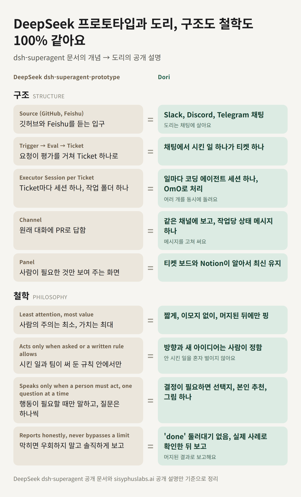

[English](README.md) · [简体中文](README.zh-CN.md) · [日本語](README.ja.md) · **한국어**

<p align="center">
  
</p>

# win-dori

> **win-dori는 [sisyphuslabs/dori-superagent](https://github.com/sisyphuslabs/dori-superagent)의 Windows 이식판입니다.** upstream 커밋 [181df3e](https://github.com/sisyphuslabs/dori-superagent/commit/181df3e)를 기준으로 하고, 동작과 기본값은 upstream을 따릅니다. 여기서 더한 것은 Windows에 필요한 부분입니다. PowerShell 설치, pane 셸 인식, 자동 시작과 Slack 리스너가 들어 있는 Windows 프로필이에요. Dori 모드와 하네스의 공은 upstream 작성자들에게 있고, Windows 부분의 버그는 저희 몫입니다. 라이선스에는 원저작권 표시를 그대로 두었습니다.

Dori 모드는 코딩 에이전트 세션 하나를 늘 켜져 있는 메신저 에이전트로 바꿉니다. 사용자는 슬랙, 텔레그램, 디스코드 중 하나에서 봇 하나와 이야기합니다. Dori는 일마다 herdr 탭에 에이전트 세션을 따로 띄워 맡기고, 자기가 띄운 세션을 모두 기억하며, 일이 정말 끝났을 때만 닫습니다. PR이 머지되고, 이슈가 닫히고, 버전이 배포된 다음에요.

스킬(`skills/dori-mode/SKILL.md`와 references)과 bun + TypeScript로 만든 작은 CLI `dori`로 구성됩니다. 아직 실험 단계라 거친 부분이 남아 있어요.

## 설치

### Windows

PowerShell에서, 어느 폴더에서든 한 줄이면 됩니다. git이 없으면 winget으로 설치하고, bun과 herdr이 없으면 공식 설치 스크립트로 설치합니다(`DORI_NO_DEPS=1`로 끌 수 있어요). 메신저(Slack, Telegram, Discord 중 선택)와 자동 시작 같은 Windows 프로필은 [영문 README](README.md#windows-profile)를 참고하세요.

```powershell
irm https://raw.githubusercontent.com/useonmn/win-dori/main/install.ps1 | iex
```

어디서 실행하든 `%USERPROFILE%\.dori\src`에 설치됩니다. `install.sh`가 `~/.dori/src`를 쓰는 것과 같아서, 먼저 clone하거나 폴더로 이동할 필요가 없습니다. 다시 실행하면 그 사본을 업데이트합니다. 스킬을 `%USERPROFILE%\.agents\skills\dori-mode`에 디렉터리 정션으로 링크하므로 관리자 권한이나 개발자 모드가 없어도 됩니다. `bun install`과 `bun link`를 돌리고, bun 전역 bin 폴더가 사용자 PATH에 없으면 추가합니다. 예시 설정은 `%USERPROFILE%\.dori\config.json`에 복사합니다. 위치는 `DORI_SRC`, `SKILLS_DIR`, `DORI_HOME`으로, 저장소는 `DORI_REPO`로 바꿀 수 있습니다. PATH 변경을 반영하려면 터미널을 새로 여세요. 이미 받아 둔 체크아웃이 있다면 `.\install.ps1`(`cmd.exe`에서는 `install.cmd`)도 같은 일을 합니다. 다시 실행할 때 `git pull`을 건너뛰려면 `install.sh`처럼 `DORI_NO_PULL=1`(`true`, `yes`도 됨)을 씁니다. PowerShell에서는 `$env:DORI_NO_PULL='1'`입니다.

Windows 프로필의 슬랙 리스너는 받은 메시지에 눈 리액션을 달고 스레드에 작업 상태(기본값 `작업 중...`, `DORI_WORKING_STATUS`로 변경)를 띄웁니다. 상태는 답할 때까지 새로 고쳐 유지하고, Dori가 답하면 지운 뒤 눈 리액션을 체크 표시로 바꿉니다. 연결이 끊긴 사이의 메시지를 따라잡을 때도 똑같이 동작합니다.

### macOS와 리눅스

```sh
curl -fsSL https://raw.githubusercontent.com/useonmn/win-dori/main/install.sh | bash
```

저장소를 `~/.dori/src`에 받고, 스킬을 `~/.agents/skills/dori-mode`에 링크하고, `bun link`로 `dori`를 PATH에 올리고, 예시 설정을 `~/.dori/config.json`에 복사합니다. 에이전트가 다른 곳에서 스킬을 읽는다면 `SKILLS_DIR`를 지정하세요.

그다음 herdr 안에서 에이전트를 열고 "Dori mode"라고 말하면 됩니다.

## 슈퍼에이전트 하네스 (이식함)

이 저장소에는 [sisyphuslabs/dori-superagent](https://github.com/sisyphuslabs/dori-superagent)의 하네스도 들어 있고, Windows, macOS, 리눅스에서 돕니다. 이 절의 내용은 upstream 문서를 옮긴 것이라 "저희"는 upstream 팀을 뜻합니다. 명령은 Dori 모드의 `dori`와 겹치지 않도록 `dori-harness`로 적었습니다.

사람과 이야기하는 세션은 리드 하나입니다. 작업은 하나하나 레인(lane)으로 돌아갑니다. 레인은 자기 herdr 탭에 뜬 omo 세션 하나로, 글로 쓴 브리프를 받아 시작하고 증거가 붙은 READY로 끝납니다. 듀티(duty) 루프는 조용해진 레인을 찔러 보고, 그래도 안 되면 리드에게 올리고, 바쁜 pane에 갈 메시지는 읽을 수 있을 때까지 들고 있습니다. 머지는 게이트를 지나는데, 게이트가 요구하는 것은 정확히 그 head에서 받은 CLEAR 리뷰 영수증과 녹색 체크입니다.

### 왜 만들었나

DeepSeek이 [dsh-superagent-prototype](https://github.com/deepseek-ai/dsh-superagent-prototype)을 공개했습니다(첫 커밋 2026-10-31). 하루쯤 지나 "Exploring Super-agent Design: Towards a More Autonomous Agent System"이라는 글도 냈습니다. 글에 나온 설계는 사람하고만 대화하고 일을 나눠 주는 오래 사는 Router 세션, 티켓마다 하나씩 격리된 Worker 세션, 턴마다 묶어서 처리하는 이벤트 트리거, 그리고 watchdog입니다. README에는 리서치 프로토타입이라고 적혀 있고, 내건 철학은 "take as little human attention as possible, and give as much value as possible"입니다.

같은 구조를 저희는 여섯 달쯤 전부터 공개된 자리에서 돌려 왔습니다.

- 2026-04-18: omo에 팀 모드가 들어갔습니다. 터미널 pane마다 에이전트 세션 하나, 세션마다 worktree 하나입니다([f1268c0](https://github.com/code-yeongyu/oh-my-openagent/commit/f1268c0), [e303fee](https://github.com/code-yeongyu/oh-my-openagent/commit/e303fee)).
- 2026-05-06: Dori라는 이름이 omo README에 올라갔습니다([#3807](https://github.com/code-yeongyu/oh-my-openagent/pull/3807)).
- 2026-10-07: dori-superagent 저장소가 `omo-dori-mode-experimental`이라는 이름으로 Dori 모드를 공개했습니다([ce53e4d](https://github.com/sisyphuslabs/dori-superagent/commit/ce53e4d)). 에이전트 하나가 일마다 herdr 탭에 에이전트 세션을 따로 띄워 맡기고, 일이 끝나야 닫습니다. git 히스토리가 공개돼 있습니다.
- 2026-10-31: DeepSeek 프로토타입의 첫 커밋.
- 2026-11-01 무렵: DeepSeek의 글.

매일 이렇게 일합니다. omo는 star가 7만 개를 넘었습니다. 2026-10-03부터 2026-11-02까지 31일 동안 [작성자의 GitHub 기여 그래프](https://github.com/code-yeongyu)에 찍힌 contribution은 38,656건입니다. 하루 평균 약 1,250건이고, 최고치는 2026-10-16의 2,227건과 2026-10-29의 2,001건입니다. 하루에 많게는 2,000건 가까이이고, 이 셋업의 풀 버전으로 낸 숫자입니다.

이 저장소 루트의 하네스는 그 최소 버전입니다. herdr와 omo만으로 돌아가는 부분만 있고, 다른 것은 붙이지 않았습니다.

### 같은 구조, 같은 철학

DeepSeek 프로토타입의 문서를 Dori 옆에 놓으면 개념이 하나하나 맞물립니다. 파이프라인 구조가 그렇고, [철학 문서](https://github.com/deepseek-ai/dsh-superagent-prototype/blob/main/docs/000-philosophy.md)의 규칙도 그렇습니다.



#### 구조

| DeepSeek dsh-superagent | Dori |
|---|---|
| Source: GitHub, Feishu | Dori는 채팅에 삽니다. Slack, Discord, Telegram |
| Trigger, Eval, Ticket 순서 | 채팅에서 부탁한 일 하나가 티켓 하나가 됩니다 |
| 티켓마다 Executor 세션 하나: 세션 하나, 작업 디렉터리 하나 | 작업마다 코딩 에이전트 세션 하나. omo 위에서 돌고, 여러 개가 병렬로 돕니다 |
| Channel: 원래 대화에 답함, 예를 들어 PR로 | 같은 채널에 보고합니다. 작업당 상태 메시지 하나를 제자리에서 고쳐 씁니다 |
| Panel: 사람이 봐야 할 것만 보여 줌 | 티켓 보드와 Notion이 알아서 최신 상태를 유지합니다 |

#### 철학

| DeepSeek dsh-superagent | Dori |
|---|---|
| 사람의 주의는 최소로, 가치는 최대로 | 짧은 메시지, 이모지 없음, 핑은 머지 뒤에 한 번 |
| 부탁받았거나 글로 적힌 팀 규칙이 허용할 때만 움직임 | 방향과 새 아이디어는 사람이 정합니다. 아무도 시키지 않은 일을 Dori가 시작하지는 않습니다 |
| 사람이 움직여야 할 때만 말하고, 질문은 한 번에 하나 | 결정 요청에는 선택지, Dori의 추천, 그림 한 장이 같이 갑니다 |
| 정직하게 보고하고, 막힌 것을 우회하지 않음 | 증거 없는 'done'은 없습니다. 실제 사례로 확인하고, 머지된 결과를 보고합니다 |

Dori 열은 저희가 실제로 굴리는 프로덕션 Dori와 Dori 모드(`skills/dori-mode`)입니다. 이 저장소 루트의 하네스는 그중 레인, 인박스, 듀티, 머지 게이트 부분을 herdr와 omo 위에 구현합니다.

### 아키텍처


역할은 셋이고, 각각 herdr pane 하나에 뜬 omo 세션입니다. herdr가 워크스페이스, 탭, pane을 만들어 주고, pane 안의 omo를 에이전트로 알아보고, 그 상태(idle, working, blocked, done)를 CLI로 알려 줍니다. dori는 pane에 무엇을 하든 그 전에 이 상태부터 읽습니다.

리드는 사람과 대화하는 유일한 세션입니다. 요청을 브리프로 바꾸고, `dori-harness start`로 레인을 열고, 레인이 보내오는 것을 읽고, 머지합니다.

레인은 자기 herdr 탭에 뜬 omo 세션 하나입니다. 브리프 하나에 레인 규칙(`prompts/lane-footer.md`)을 덧붙여서 시작합니다. 중간 결과는 `dori-harness report`로 보고하고 `dori-harness ready`로 끝내는데, `dori-harness ready`는 증거 링크가 없으면 나가지 않습니다.

듀티 루프는 `dori-harness duty --interval 60`입니다. 듀티 omo 세션 옆 pane에서 도는 보통 프로세스입니다. 틱마다 idle이 된 pane에 쌓인 메시지를 밀어 넣고, 조용한 레인을 찔러 보고, 리드에게 올리고, pane이 사라진 레인은 lost로 표시합니다. 긴급 정지는 `dori-harness duty stop --text "이유"`입니다. `dori-harness duty resume` 전까지 틱마다 `DUTY stopped: <이유>`만 출력하고 듀티 일은 모두 건너뜁니다(밀어 넣기, 찌르기, 올리기, 듀티 카운트 없음). 쌓인 메시지는 inbox에서 기다립니다. `dori-harness duty status`는 멈췄는지와 그 이유를 보여 줍니다.

상태는 `~/.dori`(또는 `$DORI_HOME`) 아래 JSON입니다. `lanes/`, `inbox/`, `briefs/`, `receipts/`, 그리고 한 시간 루프가 쓰는 `backlog/`와 `loop/`, 듀티 루프의 정지 파일이 놓이는 `duty/`. 에이전트 세션을 빼면 하네스가 더하는 상주 프로세스는 듀티 루프와 한 시간 루프 둘뿐이고, 런타임 의존성은 Bun 하나뿐입니다.


`dori-harness start <key> --brief FILE`은 브리프와 레인 규칙을 `~/.dori/briefs/<key>.md`에 쓰고, 탭을 열고, `omo 'Read your brief at <path> and execute it. Your lane key is <key>.'`를 실행하고, 레인을 `working`으로 기록하고, 리드에게 `[START <key>]`를 보냅니다. 그다음부터 레인은 보고하고(`[REPORT <key>]`, 자기 pane 바깥의 무언가에 막혔으면 `[REPORT <key> WAITING]`), 증거 링크를 붙인 `[READY <key>]`로 끝냅니다. 리드는 증거를 확인하고, PR이 있으면 `dori-harness review`와 `dori-harness merge`를 돌리고, `dori-harness done <key>`로 레인을 닫습니다. 가만히 있는 레인은 10분과 20분에 nudge를 받고 40분에 리드로 올라갑니다(`[ESCALATE <key>]`). READY 전에 pane이 사라진 레인은 `[LOST <key>]`로 보고됩니다.

### DeepSeek super-agent 대응표

| DeepSeek super-agent | dori | 이 저장소에서 |
|---|---|---|
| Router 세션: 사람과 대화하고 일을 나눠 줌 | LEAD 세션: 사람과 대화하는 유일한 세션. 레인을 열고 머지함 | `prompts/lead.md`, `src/cli.ts`의 `up()` |
| Worker 세션, 티켓마다 하나 | LANE: 작업마다 omo 세션 하나. 자기 herdr 탭과 자기 브리프 | `src/harness.ts`의 `startLane()`, `prompts/lane-footer.md` |
| Ticket + Mandate | 브리프 파일 + 레인 규칙 푸터, 그리고 증거가 꼭 붙어야 하는 READY | `~/.dori/briefs/<key>.md`, `src/harness.ts`의 `ready()` |
| 트리거 배칭: 이벤트를 턴마다 묶음 | pane 인박스: 바쁜 pane에 보낸 메시지는 큐에 쌓였다가 idle이 되면 한 묶음으로 도착 | `src/harness.ts`의 `send()`, `flushInbox()`; `src/store.ts`의 `inbox/` |
| Watchdog | DUTY 루프: 인박스를 비우고, 10/20분에 nudge, 40분에 리드로 올리고, 사라진 pane 감지 | `src/harness.ts`의 `dutyTick()`, `prompts/duty.md`, `prompts/nudge.md` |
| Admission matrix, `maxWorkers`(기본 3) | 한 시간 루프 예산: 열린 레인 `--max-lanes`(기본 3)개, 한 번에 `--max-starts`(기본 2)개, 부하가 큰 호스트에서는 시작 안 함 | `src/loop.ts`의 `loopTick()` |
| 프로토타입에 없음 | 게이트 머지: 정확한 head SHA의 CLEAR 리뷰 영수증 + 녹색 체크. 빈 체크 목록은 녹색이 아님 | `src/harness.ts`의 `review()`, `mergeGate()`, `prompts/review.md`, `src/store.ts`의 `receipts/` |
| 프로토타입에 없음 | 한 목소리 규칙: 레인과 듀티는 사람과 대화하지 않음 | `prompts/lead.md`, `prompts/duty.md`, `prompts/lane-footer.md` |
| 프로토타입에 없음 | 답변 전문 장부: 레인마다 최종 답변, 증거 링크, 로그를 디스크에 보관 | `src/store.ts`의 `Lane.final`, `Lane.log` |

### 빠른 시작

Bun 1.3 이상, herdr, omo, 그리고 GitHub CLI `gh`가 필요합니다. `gh`는 PR의 head SHA와 체크를 읽고 머지할 때 씁니다.

```sh
git clone https://github.com/useonmn/win-dori
cd win-dori
bun install
bun link   # puts `dori-harness` on your PATH; or write `bun src/cli.ts` in its place
```

herdr를 띄운 다음 셸에서:

```sh
dori-harness up
# UP lead=w1:p1 duty=w1:p2 loop=w1:p3 hourly=w1:p4 home=~/.dori
```

`dori`라는 herdr 워크스페이스가 열립니다. 리드 pane(시스템 프롬프트 뒤에 `prompts/lead.md`를 붙인 omo), 듀티 pane(`prompts/duty.md`를 붙인 omo), 그 아래 듀티 루프, 또 그 아래 한 시간 루프입니다. 리드 pane에 말을 걸면 됩니다. 리드가 브리프(목표, 입력, 결과물, 종료 조건, 제약. [`examples/brief.md`](examples/brief.md) 참고)를 쓰고 레인을 직접 엽니다. 셸에서 열어도 됩니다.

```sh
dori-harness start fix-flaky-login --brief examples/brief.md
# STARTED fix-flaky-login pane=w1:p5 brief=~/.dori/briefs/fix-flaky-login.md
dori-harness status
# lead=w1:p1 duty=w1:p2 home=~/.dori
# fix-flaky-login          working  w1:p5    active 0m ago  start: examples/brief.md
```

레인 키는 `^[a-z][a-z0-9-]{1,40}$`에 맞아야 하고, 이미 열린 키는 거절됩니다.

레인 안의 omo는 레인 규칙이 건네준 명령으로 보고하고 끝냅니다.

```sh
dori-harness report fix-flaky-login --text 'reproduced: 1 failure in 20 runs, shared session fixture'
dori-harness report fix-flaky-login --status waiting --text 'WAITING: checks on owner/repo#12'
dori-harness ready fix-flaky-login --text 'root cause fixed in owner/repo#12, checks green' --evidence https://github.com/owner/repo/pull/12
```

리드는 `[READY fix-flaky-login]`을 받으면:

```sh
dori-harness review owner/repo#12            # fresh omo reviewer pinned to the head SHA; writes a receipt; exit 0 on CLEAR
dori-harness merge owner/repo#12 --dry-run   # MERGE_OK ... (dry run), or MERGE_REFUSED <why> with exit 2
dori-harness merge owner/repo#12             # gh pr merge --squash --match-head-commit <sha>
dori-harness done fix-flaky-login            # closes the lane's pane; only a READY lane can be closed
```

`dori-harness send <lead|duty|key|pane> --text '...'`는 pane에 메시지를 전달하고, pane이 바쁘면 큐에 넣습니다. `dori-harness role <lead|duty> [PANE]`은 `dori-harness up`을 쓰지 않았을 때 pane을 손으로 등록합니다. `--text`를 빼면 stdin에서 읽습니다. 에이전트가 보는 명령은 `src/cli.ts`의 전체 경로로 렌더링되므로, 에이전트의 PATH에 `dori-harness`가 없어도 됩니다. 환경 변수는 `DORI_HOME`(상태 디렉터리, 기본 `~/.dori`), `DORI_AGENT_CMD`(기본 `omo`), `DORI_HERDR_SESSION`(이름 붙인 herdr 세션), `DORI_CMD`(에이전트에게 알려 줄 dori 호출법), `DORI_PANE_SHELL`(pane 셸 지정)입니다.

Dori 모드는 같은 폴더의 `state/`와 `config.json`을 쓰므로 서로 덮어쓰지 않습니다. 따로 두고 싶으면 `DORI_HOME`을 다른 폴더로 지정하세요.

### Windows pane 셸

하네스는 pane에 명령줄을 타이핑해서 움직이므로 셸마다 인용 규칙이 달라야 합니다. pwsh 7, Windows PowerShell 5.1, cmd, Git Bash 네 가지 모두 지원하고, 실제 herdr 서버 위의 테스트로 확인했습니다. 새 pane을 열 때마다 그 pane의 셸을 herdr에 물어보고, `DORI_PANE_SHELL`(`posix`, `pwsh`, `powershell`, `cmd`)을 주면 그 값을 먼저 씁니다. cmd pane에서는 에이전트 실행 줄을 `powershell -EncodedCommand`로 감싸서 PowerShell 5.1이 해석하므로, 에이전트가 `.ps1` 심이면 실행 정책의 영향을 받습니다. `src/cli.ts` 경로에 `$`, 백틱, `%`, `"`가 들어 있으면 네 셸에 모두 맞는 표기가 없으니 `DORI_CMD`를 지정하세요. Windows에는 유닉스식 부하 평균이 없어서, 한 시간 루프는 CPU 사용률에 코어 수를 곱하고 프로세서 대기열을 더한 값을 부하로 봅니다.

### 하네스가 강제하는 것

목소리는 하나입니다. 사람과 대화하는 세션은 리드뿐입니다(`prompts/lead.md`). 레인 규칙은 사람에게 갈 사실을 전부 리드로 보내라고 하고(`prompts/lane-footer.md` 3번 규칙), 듀티 세션은 머지도 하지 않고 사람과 대화도 하지 않습니다(`prompts/duty.md`). 레인이 하는 일은 전부 리드 pane에 프롬프트로 들어갑니다. `[START]`, `[REPORT]`, `[READY]`, `[LOST]`, `[ESCALATE]`.

READY에는 증거가 붙어야 합니다. `dori-harness ready`는 `--evidence` 링크가 하나도 없거나 최종 답변 텍스트가 없으면 거절합니다(`src/harness.ts`의 `ready()`). 텍스트와 링크는 레인 레코드에 `final`로 저장되고, `dori-harness done`은 `ready`가 아닌 레인을 거절합니다. 그래서 답변이 기록되지 않은 채 닫히는 레인은 없습니다.

바쁜 pane은 건드리지 않습니다. `dori-harness send`는 먼저 herdr에 그 pane의 에이전트 상태를 묻습니다. `idle`이나 `done`이면 바로 전달하고, 그 밖의 상태면 `~/.dori/inbox/`에 큐로 넣고 `QUEUED`를 출력합니다. 에이전트가 앞에서 돌고 있지 않은 pane(에이전트가 종료돼 셸(pwsh, powershell, cmd, bash)이 프롬프트에 남은 경우. macOS와 Linux에서는 Ctrl+Z로 멈춘 경우도 포함)에는 절대 입력하지 않습니다. 셸에 입력한 텍스트는 명령으로 실행되기 때문입니다. 그 pane의 메시지는 큐에 남고, 에이전트가 다시 뜰 때까지 듀티 루프가 `inbox-held`를 출력합니다. 일반 셸에 일부러 입력하려면 운영자가 `--to-shell`을 붙입니다. 그 메시지 하나에만 적용되고 큐에 있는 메시지에는 적용되지 않습니다. Windows에서는 herdr의 process-info가 pane의 셸만 보여 주므로 하네스가 herdr의 에이전트 상태로 판단하고, `--to-shell`은 줄마다 Enter를 따로 눌러 입력합니다. pane이 idle이 되면 듀티 루프가 큐를 메시지 하나로 전달하는데, 그 메시지는 "N messages arrived while you were busy"로 시작합니다(`src/harness.ts`의 `send()`와 `flushInbox()`). `dori-harness done`도 같은 식으로 기다립니다. herdr가 working이나 blocked라고 하는 pane은 닫지 않습니다.

nudge는 10분, 20분, 40분입니다. `src/harness.ts`의 `NUDGE_MINUTES = [10, 20, 40]`입니다. 10분 동안 보고가 없고 pane도 working이 아닌 레인은 자기 pane에 `prompts/nudge.md`를 받습니다. 20분에 한 번 더 받습니다. 40분이 되면 듀티 루프는 nudge를 그만두고 리드에게 `[ESCALATE <key>]`를 보냅니다. `working`인 pane은 idle 시계가 되돌아가고, `--status waiting`으로 보고했거나 pane이 `blocked`인 레인은 건드리지 않고, 새 보고가 오면 nudge 횟수가 0으로 돌아가고, pane이 사라지면 `[LOST <key>]`로 보고됩니다.

머지에는 정확한 head의 CLEAR 영수증과 녹색 체크가 필요합니다. `dori-harness merge`는 `gh`로 PR의 head SHA를 읽고, 그 SHA에 대한 영수증이 `~/.dori/receipts/`에 verdict `CLEAR`로 있어야 넘어갑니다. 영수증을 쓰는 것은 `dori-harness review`뿐입니다. `dori-harness review`는 그 SHA에 고정한 `prompts/review.md`로 새 비대화형 omo(`omo -p --no-session`, 필요하면 `--model`)를 돌리고, 리뷰어가 `VERDICT:` 줄을 출력하지 않으면 영수증을 쓰지 않습니다. 그다음 `gh pr checks`가 체크를 하나 이상 돌려줘야 하고, 모든 체크가 `pass`나 `skipping`이어야 하고, 그중 하나 이상은 `pass`여야 합니다. 빈 체크 목록은 "an empty check list is never green"으로 거절합니다. 머지 자체는 `gh pr merge --squash --match-head-commit <sha>`입니다. 리뷰 뒤에 push가 들어오면 head SHA가 바뀌어 영수증이 맞지 않게 되고, 머지는 거절됩니다(`src/harness.ts`의 `review()`와 `mergeGate()`).

### 한 시간 루프

`dori-harness up`은 네 번째 pane에서 `dori-harness loop`도 띄웁니다. 한 시간마다 하네스 상태를 실제와 맞춰 보고, 누구의 결정도 필요 없는 다음 일을 직접 시작합니다. 리드가 다음 할 일을 기억하고 있지 않아도 됩니다. 전체 설계는 [`docs/hourly-loop.md`](docs/hourly-loop.md)에 있습니다.

할 일은 `~/.dori/backlog/`의 백로그에 항목당 브리프 하나로 쌓입니다. 리드가 넣거나, 라벨이 붙은 열린 GitHub 이슈를 가져옵니다.

```sh
dori-harness backlog add search-index --brief briefs/search.md --priority 2
dori-harness backlog add new-billing --brief briefs/billing.md --decision '좌석 과금이야, 워크스페이스 과금이야?'
dori-harness backlog import owner/repo --label dori     # p1..p9 라벨은 우선순위, needs-decision 라벨은 질문
dori-harness backlog list
```

루프는 먼저 관문을 봅니다. 멈춰 있거나, 다른 루프가 잠금을 쥐고 있거나, 마지막 실행에서 간격(기본 한 시간, `--force`면 이 확인을 건너뜀)이 안 지났으면 아무것도 하지 않습니다. 관문을 통과한 실행은 다음 다섯 가지를 순서대로 합니다.

1. 동기화. 레인이 끝났거나 READY의 PR이 머지된 항목은 done이 됩니다. 레인이 lost된 항목은 다시 큐로 돌아가고, 두 번 잃으면 질문으로 바뀝니다. 가져온 이슈가 닫힌 항목은 빠집니다.
2. 놓친 일 점검. 3시간째 보고가 없는 레인, READY인데 2시간째 아무도 닫지 않은 레인, pane이 사라진 레인을 찾습니다.
3. 다음 일 당기기. 질문이 걸리지 않은 열린 항목을 우선순위, 그다음 오래된 순으로 시작합니다. 시작이 두 번 실패한 항목은 질문으로 바뀌어서 뒤의 항목을 막지 않습니다. 열린 레인은 `--max-lanes`(기본 3)개까지, 한 번에 `--max-starts`(기본 2)개까지입니다. 1분 부하가 코어 수(또는 `--max-load`)를 넘거나 쓸 수 있는 메모리가 10% 밑이면(macOS에서는 빈 페이지만 세면 늘 0에 가까워서 커널의 가용 메모리 수준을 씁니다) 아무것도 시작하지 않습니다.
4. 묻기. 열린 질문은 `[DECIDE <id>]`로 리드에게 한 번 가고, 6시간 뒤에 한 번만 다시 갑니다. 리드가 사람에게 묻고, 답을 `dori-harness backlog decide <id> --text '...'`로 남기거나(답은 항목 브리프 끝에 붙습니다) `dori-harness backlog drop <id>`로 뺍니다.
5. 보고. 열린 레인 수와 한도, 백로그 개수, 호스트 부하와 남은 메모리, 찾은 것들을 `[LOOP ...]` 메시지 하나로 리드에게 보냅니다. 관문을 통과한 실행은 `~/.dori/loop/runs/`에도 기록이 남습니다.

자기 상태 파일(백로그 항목, 실행 기록, 잠금)을 빼면 루프는 레인을 열고 메시지를 보내는 일만 합니다. 머지, 푸시, pane 닫기는 하지 않고, 열린 레인의 기록도 고치지 않습니다(lost된 항목을 다시 하면 같은 키로 새 레인을 엽니다). `gh`는 읽기만 합니다. 긴급 정지는 `dori-harness loop stop --text "이유"`입니다. `dori-harness loop resume` 전까지 루프는 아무것도 하지 않습니다. 잠금과 마지막 실행 기록이 있어서 루프 두 개가 같은 시간대를 두 번 돌지 않고, cron에서 `dori-harness loop --once`를 같이 돌려도 안전합니다. `dori-harness loop status`는 마지막 실행을 보여 줍니다.

### 텔레메트리

텔레메트리는 기본으로 켜져 있습니다. `dori-harness`는 omo와 같은 방식으로 익명 사용 횟수를 보냅니다. OTLP/HTTP JSON 로그를 omo 수집기 `https://t.omo.dev`로 보냅니다. 식별자는 `~/.dori/telemetry.json`에 둔 무작위 설치 id 하나이고, 보내는 것은 그 sha256뿐입니다. 첫 전송 때 수집기가 그 해시로 설치별 ingest 키를 발급하고(`POST /v1/register`), 키는 `~/.dori/telemetry.json`에 캐시해 두고 수집기가 401로 거절하면 다시 발급받습니다. 코드에 공유 키는 들어 있지 않습니다. 처음 실행하면 한 줄 안내가 뜹니다. `DORI_TELEMETRY=0`으로 끕니다(`DO_NOT_TRACK=1`도 됩니다). `DORI_TELEMETRY_ENDPOINT`는 수집기 URL을 바꿉니다.

| 이벤트 | 언제 | 필드 |
|---|---|---|
| `dori.installed` | 첫 실행 | 없음 |
| `dori.daily_active` | 어떤 `dori-harness` 명령이든, UTC 하루에 한 번 | `day_utc` |
| `dori.lane_started` | `dori-harness start` | `open_lanes` |
| `dori.lane_ready` | `dori-harness ready` | `evidence_count`, `lane_minutes` |
| `dori.review_completed` | `dori-harness review` | `verdict`: `CLEAR` 또는 `BLOCK` |
| `dori.merge_decided` | `--dry-run`이 아닌 `dori-harness merge` | `outcome`: `merged`, `no_receipt`, `review_block`, `no_checks`, `checks_red`, `checks_all_skipped` |
| `dori.duty_summary` | 듀티 루프에서 한 시간에 최대 한 번 | `ticks`, `flushed`, `nudges`, `escalations`, `lost` |

일간, 주간, 월간 활성 수는 `dori.daily_active`로 셉니다. 활성 수는 설치 단위로 세기 때문에, 두 실행이 같은 순간에 시작해 드물게 한 번 더 보내도 숫자는 바뀌지 않습니다. 레코드마다 리소스 필드가 같이 붙습니다. 서비스 이름과 버전, 설치 해시, CI 여부, OS 종류와 버전, CPU 아키텍처입니다. OS 종류는 `darwin`, `linux`, `windows` 중 하나이고, 그 밖의 OS에서는 아무것도 보내지 않습니다. 경로, 저장소 이름, PR 번호, 레인 키, 브리프, 메시지, 그 밖의 어떤 텍스트도 보내지 않습니다. 전송은 백그라운드에서 요청마다 2초 타임아웃으로 돌고, 명령은 끝나기 전에 최대 2초까지만 기다립니다. 텔레메트리가 실패해도 명령은 실패하지 않습니다.

### 범위

최소 실험입니다. 하네스는 Bun 위의 TypeScript로 런타임 의존성이 없고, 저희의 프로덕션 스택은 아닙니다. 일부러 뺀 것은 머신 간 메시, heavy-slot 스케줄링, 채팅과 티켓 트래커 브리지, 테스트 스위트 전체에 대한 영수증입니다. 여기 있는 것은 herdr와 omo만으로 돌아가는 부분입니다. 역할, 레인, 인박스, 듀티 루프, 한 시간 루프와 백로그, 리뷰와 머지 게이트. `skills/dori-mode`의 Dori 모드는 별개의 CLI입니다. 메신저 기능, 호스트 가드, heavy-slot 러너가 따로 있고, 하네스는 거기서 아무것도 import하지 않습니다.

## 필요한 것

- [bun](https://bun.sh) 1.3 이상, git
- [herdr](https://herdr.dev): 레인이 돌아가는 터미널 멀티플렉서. Windows에서는 `powershell -ExecutionPolicy Bypass -c "irm https://herdr.dev/install.ps1 | iex"`로 설치합니다.
- 스킬을 읽는 코딩 에이전트 ([OmO](https://github.com/code-yeongyu/oh-my-openagent) 기준으로 만들었고, 에이전트 실행 명령은 설정으로 바꿀 수 있습니다)
- PR 머지와 이슈 종료 확인용 `gh`(GitHub CLI), 배포 버전 확인용 `npm`
- 봇 자체를 위한 [agent-messenger](https://github.com/agent-messenger/agent-messenger)

호스트 감시는 macOS와 Windows에서 부하, 메모리, 스왑, 디스크를 모두 읽습니다. Windows에서는 `powershell.exe` 한 번으로 읽어요. 이때 부하는 CPU 사용률에 CPU 수를 곱하고 프로세서 대기열을 더한 값이고, 약 1초 동안의 평균이라 유닉스의 1분 평균보다 많이 출렁입니다. 리눅스에서는 부하와 디스크만 보고, 메모리와 스왑은 알 수 없음으로 나옵니다.

## Dori 이름 짓기

Dori는 맨 처음에 자기를 뭐라고 부를지 묻습니다. 그냥 "Dori"도 되고, ShipDori나 WorkDori처럼 끝이 Dori로 끝나는 이름도 됩니다. 여러 개를 함께 돌릴 때 구분하기 좋습니다. 정한 이름은 봇 이름과 메시지 끝 서명, 모드 이름에 그대로 쓰입니다. 다음부터는 "ShipDori mode"라고만 하면 다시 켜집니다.

## 슬랙으로 쓸 때

슬랙을 고르면 Dori가 한 가지를 더 묻고 답을 기다립니다.

- **사용자 토큰**: 워크스페이스의 실제 멤버로 움직입니다. 유료 좌석이 하나 필요하고 그 비용은 사용자가 냅니다. 그 멤버가 볼 수 있는 건 모두 읽을 수 있고, 초록색 온라인 표시도 유지할 수 있습니다.
- **봇 토큰**: 슬랙 앱으로 움직입니다. 좌석 비용은 없지만, 초대받은 채널과 앱에 준 권한 범위 안에서만 볼 수 있습니다.

## Dori의 말투

Dori는 사용자의 말투를 따라갑니다. 짧고 편하게, 소문자로 쓰면 그대로 짧고 편하게 답합니다. 어떤 언어로 쓰든 이모지는 쓰지 않습니다. 할 말이 여러 갈래면 긴 글 하나 대신 짧은 메시지 몇 개로 나눠 보내고, 각 메시지는 준비되는 대로 바로 보냅니다. 일부러 뜸을 들이지 않아요. 계속 바뀌는 진행 상황 하나만은 예외라서, 메시지 하나를 그 자리에서 고쳐 갑니다.

## 설정

설정 파일은 `~/.dori/config.json` 하나이고, 어느 항목이든 빼도 됩니다. 보통 정해 두는 항목은 아래와 같아요.

| 항목 | 뜻 |
|---|---|
| `leadPane` | Dori 자신의 herdr pane (`herdr pane current`). 레인 보고가 여기로 옵니다. |
| `laneWorkspace` | 새 레인 탭이 열릴 herdr workspace |
| `defaultCwd` | 레인이 시작하는 디렉터리이자, 레인이 worktree를 만드는 저장소 |
| `agentCommand` | 에이전트 실행 명령. `{model}`, `{prompt}`가 들어간 argv 목록 |
| `paneShell` | 레인 pane의 셸: `auto`(기본값), `posix`, `pwsh`, `powershell`, `cmd`. `auto`는 Windows가 아니면 posix입니다. Windows에서는 herdr에 pane의 셸을 물어보고, 모르면 `pwsh`로 봅니다. pane 셸이 늘 같다면 직접 정해 두세요. |
| `hooks.threadReply`, `hooks.threadDone` | 메신저 CLI를 `{thread}`, `{text}`가 들어간 argv 목록으로. 레인 진행 상황을 올리고 완료 표시를 할 때 씁니다. |

나머지(시간, 임계값, heavy 슬롯 수)는 기본값으로 충분합니다. 전체 표는 [`references/scripts.md`](skills/dori-mode/references/scripts.md)에 있습니다. `DORI_CONFIG`, `DORI_STATE_DIR`, `DORI_LEAD_PANE` 환경변수를 주면 파일 값 대신 그 값을 씁니다.

## 온보딩

처음 설정할 때 Dori는 아무것도 읽기 전에 먼저 허락을 구합니다. 어떤 도구를 쓰는지, 무슨 일을 왜 하는지, 사용자와 회사가 어떤 곳인지 알아봐도 되느냐고요. 허락해야만 도구를 하나씩 살펴봅니다. 도구마다 어떤 연동을 쓸지, 그게 무엇을 읽는지 설명하고 따로 묻습니다. 예를 들면 "Gmail과 캘린더를 읽는 CLI로 일정과 메일을 지켜봐도 될까요?" 하는 식입니다. 거절한 도구는 건너뛰고, 거절했다는 사실도 기억합니다.

전 과정은 읽기만 합니다. 알게 된 내용은 그때그때 메모리에 적고, 마지막에 무엇을 알게 됐고 무엇이 아직 비어 있는지 짧게 정리해 줍니다. 자세한 절차는 [`references/onboarding.md`](skills/dori-mode/references/onboarding.md)에 있어요.

## 요청 처리 방식

메시지마다 어떻게 처리할지는 Dori가 스스로 정합니다.

- 질문, 상태 확인, 조회, 몇 번의 도구 호출로 끝나는 작은 수정은 새 세션 없이 바로 처리합니다.
- PR로 끝나는 코드 작업, 여러 단계짜리 일, 오래 걸리거나 나눠서 돌릴 수 있는 일은 레인을 엽니다. 그 저장소를 맡고 있는 쉬는 레인이 있으면 새로 열지 않고 거기에 맡깁니다.
- 메모리, 디스크, pane 수에 여유가 없으면(`dori can-launch`가 HOLD) 새 레인을 열지 않습니다. 일을 대기열에 넣고 이유를 알려 줍니다.
- 새 일은 새 스레드에서 시작합니다. 이어지는 일은 원래 스레드로 돌아가고, 레인이 닫혔으면 예전 세션을 다시 엽니다. 짧은 질문은 물어본 자리에서 답합니다.

## 세션 레지스트리

레인마다 `~/.dori/state/lanes/` 아래에 JSON 파일이 하나씩 생깁니다. 메신저 스레드와 herdr pane, pane과 에이전트 세션 id를 연결하고, 상태(`working`, `done-claimed`, `verified-done`, `not-done`, `closed`)와 그 변화 이력을 남깁니다.

`dori sync`는 이 기록을 실제로 떠 있는 pane과 비교해서 어긋난 곳을 알려 줍니다. 사라진 pane, 바뀐 세션 id, 끝났다는 걸 증명할 방법이 없는 레인 같은 것들입니다. 아무것도 지우지 않습니다. `--write`를 붙이면 찾은 세션 id를 저장합니다.

## 5분 완료 흐름

레인이 끝났다고 알립니다.

```sh
dori claim-done fix-login --evidence "merged acme/app#412 (a1b2c3d)"
```

Dori는 `LANE_DONE_CLAIMED`를 받고, 레인에는 5분 뒤 닫힌다는 메시지가 갑니다. 그 사이에 반대하려면 이렇게 합니다.

```sh
dori object-done fix-login --reason "changelog 항목이 빠졌음"
```

적은 이유가 레인에 그대로 전달되고, 레인은 고친 뒤 다시 완료를 알립니다. 아무도 반대하지 않으면 시간이 지난 뒤 `dori watch`가 레인을 닫습니다. 닫기 전에 `Done =` 신호를 모두 실제로 다시 확인하고, worktree에 원격에 올라가지 않은 커밋이나 커밋하지 않은 변경이 있으면 닫지 않습니다. 이때 완료 요청은 이유와 함께 not-done으로 돌아갑니다. watcher를 다시 켜도 5분 시계는 처음부터 다시 세지 않습니다.

### 무엇을 완료로 보나

레인의 `Done =` 줄에는 watcher가 직접 확인할 수 있는 신호를 적습니다.
- PR 머지
- 이슈 종료
- 패키지 버전 배포
- PR로 끝나지 않는 일(로컬 설정, QA, 띄워 둔 서비스)이라면, 종료 코드 0으로 끝나는 명령, 해시나 JSON 값이 맞는 파일, 기대한 상태 코드와 본문으로 응답하는 URL

```
Done = command ["bun","test"]; file qa/report.json json:.passed=true; url http://localhost:3000/health body~"ready"
```

명령은 `["bun","test"]`처럼 argv로 적으세요. 그러면 같은 줄이 Windows, macOS, 리눅스에서 모두 돌아갑니다. Windows에서 `file C:\Users\ana\qa\report.json` 같은 경로는 적힌 그대로 읽으므로 역슬래시 하나로 충분합니다.

watcher는 레인을 닫을 때 셸 없이 이 확인을 직접 다시 돌리고, 레인이 됐다고 한 말을 그대로 믿지 않습니다. 해석할 수 없는 신호는 레인을 띄울 때 거부합니다. 전체 문법은 [`references/sessions.md`](skills/dori-mode/references/sessions.md)에 있어요.

## 명령

| 명령 | 하는 일 |
|---|---|
| `dori launch <key> ...` | brief에 레인 footer를 쓰고, 탭을 열고, 에이전트를 시작하고, 시작 오류를 확인 |
| `dori adopt <key> --pane ID ...` | 이미 돌고 있는 레인을 등록 |
| `dori sync [--write]` | 레지스트리와 실제 pane 비교, 어긋난 곳 표시 |
| `dori claim-done` / `object-done` / `close` | 완료 흐름 |
| `dori pause` / `resume` | 소유자가 기다리라고 할 때: 깨우지 않고, 목표를 멈추고, 진행 중인 턴을 멈춤. 그리고 재개 |
| `dori watch` | 자동 닫기 watcher. 지속 모니터로 돌립니다 |
| `dori freshness [--loop MIN]` | 조용해진 레인을 깨우고, 마지막 보고를 스레드에 올림 |
| `dori dead-panes [--loop MIN]` | 멈춘 에이전트 pane 보고 |
| `dori guard [--loop MIN]` | 부하, 메모리, 디스크, pane 수 경고 |
| `dori heavy <label> -- <cmd>` | 슬롯이 비고 부하가 낮을 때만 빌드나 테스트 실행 |

pane에 보내는 글은 항상 인자 하나로 넘기고 셸 문자열을 거치지 않습니다. 전송 결과는 전달됨 또는 미확인으로 보고합니다.

## 유틸리티

CLI에는 Dori에게 필요한 메신저 기능도 들어 있습니다. `scripts/src/messenger/` 아래 타입이 붙은 모듈로 가져다 쓸 수도 있어요.

| 명령 | 하는 일 |
|---|---|
| `dori send slack\|telegram\|discord --to T --text X [--thread ID] [--edit ID]` | 메시지 보내기와 수정. rate limit은 기다렸다 다시 보내고, `$(`가 들어간 글은 거부합니다 |
| `dori presence slack\|discord` | 계정을 온라인으로 유지. 디스코드 봇은 게이트웨이로, 슬랙 사용자 계정은 1분마다 신호를 보내는 웹 클라이언트 소켓으로 유지합니다 |
| `dori transcribe <file>` | `hooks.transcribe` 명령으로 음성 메시지를 글로 변환 |
| `dori can-launch` | 레인을 하나 더 열 여유가 있는지 확인 |
| `dori inbound slack [--loop MIN]` | 슬랙에서 Dori에게 온 것을 빠짐없이 잡기. Threads 화면의 읽지 않은 답글, Dori가 글을 쓴 스레드의 새 답글(태그가 없어도), 읽지 않은 멘션이 있는 DM과 채널 |

명령은 없지만 모듈로 제공되는 기능도 있습니다.
- 텔레그램: "Thinking…"으로 시작하는 `sendMessageDraft` 스트리밍, 포럼 토픽, HTML 표
- 디스코드: 스레드 만들기, 이름 바꾸기, 보관
- 슬랙: 파일 업로드
- `typingWhile`: 작업이 도는 동안 입력 중 표시를 띄워 둡니다

슬랙에서 Dori가 보내는 메시지는 어떤 함수로 보냈든 그 스레드를 기록해 둡니다. 원시 API 호출로 올린 글 아래에 태그 없이 달린 답글도 놓치지 않는데, 메시지 이벤트만 듣는 방식으로는 이런 답글을 놓칩니다.

토큰은 `DORI_SLACK_TOKEN`(사용자 토큰이면 `DORI_SLACK_COOKIE`도), `DORI_TELEGRAM_TOKEN`, `DORI_DISCORD_TOKEN`에서 읽습니다.

## 테스트

main 푸시와 PR마다 GitHub Actions CI(Windows, Ubuntu)가 가드, 타입 검사, 테스트를 돌립니다. 로컬에서는 이렇게 돌립니다.

```sh
cd skills/dori-mode/scripts
bun install
bun test           # 가짜 herdr, git, gh로 동작을 확인하는 테스트
bunx tsc --noEmit  # 타입 검사
```

하네스 테스트는 저장소 루트에서 `bun test ./test/`로 돌립니다. 모델은 부르지 않고, Windows에서는 네 가지 셸의 private herdr 서버를 띄웁니다.

Windows PowerShell에서도 같은 명령으로 돌아갑니다. 실제 pane이나 저장소, GitHub는 건드리지 않아요.

## 라이선스

MIT

## OmOMeow에서 옮겨 오기

예전 gist로 OmOMeow 모드를 쓰고 있었다면 봇은 그대로 동작합니다. 네 가지만 바꾸면 Dori가 됩니다.

1. **Dori 이름 정하기.** 그냥 "Dori"나 ShipDori, WorkDori처럼 Dori로 끝나는 이름이면 됩니다. 에이전트에게 "이제부터 네 이름은 ShipDori고, 이건 ShipDori mode야"라고 말하세요. 그다음부터는 "OmOMeow mode" 대신 "ShipDori mode"가 모드를 켜는 말이 됩니다.
2. **봇 이름과 프로필 사진 바꾸기.**
   - 텔레그램: @BotFather에서 `/setname`을 보내고 봇을 고른 뒤 새 이름을 보냅니다. 이어서 `/setuserpic`을 보내고 봇을 고른 뒤 새 이미지를 보냅니다. 기본 Dori 그림은 [`skills/dori-mode/assets/dori-avatar.png`](skills/dori-mode/assets/dori-avatar.png)이고, 원하는 이미지로 바꿔도 됩니다. 봇 이름과 사진은 BotFather에서만 바꿀 수 있습니다.
   - 디스코드: Developer Portal에서 애플리케이션을 엽니다. **Bot** 페이지에서 사용자 이름과 아이콘을, **General Information**에서 앱 이름과 아이콘을 바꾸고(같은 기본 그림을 쓰면 됩니다) 저장합니다.
3. **이 저장소 설치하기.** 위의 한 줄 설치를 실행하고 에이전트에게 "ShipDori mode"라고 말하면, 예전에 붙여 넣던 프롬프트 대신 스킬과 `dori` CLI를 씁니다.
4. **온보딩 하기.** OmOMeow 때 한 적이 없다면 "온보딩 해 줘"라고 하면 됩니다.

기존 스레드, 토픽, 메모리는 그대로 남습니다.
