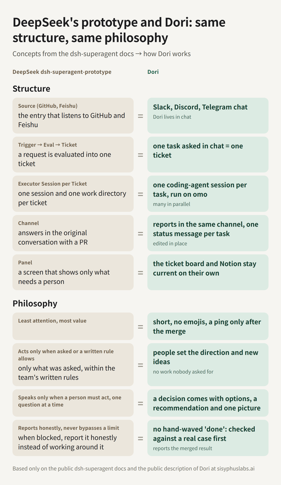

<p align="center">
  
</p>

# win-dori

Your 24/7 engineer, in the chat you already use.

English | [简体中文](README.zh.md) | [Deutsch](README.de.md) | [日本語](README.ja.md) | [Italiano](README.it.md)

[](https://github.com/useonmn/win-dori/actions/workflows/ci.yml)
[](LICENSE)

> **win-dori is the Windows port of [sisyphuslabs/dori-superagent](https://github.com/sisyphuslabs/dori-superagent).** Dori and dori-superagent are Sisyphus Labs' project; win-dori follows upstream commit [97d807b](https://github.com/sisyphuslabs/dori-superagent/commit/97d807b9037cb050a72129659cf6306d8055010d) and keeps upstream's behaviour and defaults. What it adds is what Windows needs: the PowerShell install, shell-aware panes, and a Windows profile with autostart. Credit for Dori goes to the upstream authors; bugs in the Windows parts are ours. Upstream issues belong at [sisyphuslabs/dori-superagent/issues](https://github.com/sisyphuslabs/dori-superagent/issues).

> **Licence.** Since this port win-dori is under the [Sustainable Use License](LICENSE), like upstream: personal use, internal business use and free non-commercial use only. [NOTICE.md](NOTICE.md) says what win-dori changed. Versions up to `fa86ddf` were MIT and stay MIT.

Dori lives in your Slack, Discord or Telegram. You tell him what to do in a thread, he gives the job its own coding-agent session, and he writes back when the work is proven done: a merged PR, a closed issue, a published version. Between requests he finds the next task himself. That's the whole setup.

This repository, `dori-superagent`, is Dori under the Sustainable Use License. Dori mode (`skills/dori-mode`) is the bot you talk to: a skill for your coding agent plus a `dori` CLI that opens, tracks and closes the sessions doing the work, and talks to Slack, Discord and Telegram.

The harness (`src/`) is the machine room behind him: one lead session, a duty loop, an hourly loop, as many lanes as the host carries, and a merge gate, in about 4,600 lines of TypeScript on [Bun](https://bun.sh) with no runtime dependencies. It runs on [herdr](https://github.com/herdrdev/herdr), the terminal runtime the sessions live in (or on hc, herdr-core, the headless one from the same project), and [omo](https://github.com/code-yeongyu/oh-my-openagent), the coding agent, which has 70.8k stars on GitHub.

## What you get

- You write in a thread. Dori marks the message with an "eyes" reaction, answers within a minute, and while a job runs its status is one message that he edits in place, with a short progress note every 15 minutes and at each milestone.
- Every job runs in its own herdr tab, recorded in a registry from launch to close, as many at once as the host carries. A host guard holds new launches when memory, disk or the pane count cross its line.
- No "done" without proof. A lane claims done with evidence, and the claim is checked against live state: the PR is merged, the issue is closed, the version is on npm, the command passes, the URL answers. A claim that doesn't hold goes back as not done within 5 minutes, and a lane with unpushed work can't close.
- Only the merge gets a ping. The lead is the only session that talks to you, and it reports a code change after the merge, with the PR and the merge commit. Lanes and the duty loop never talk to you.
- Work goes on while you're away. Briefs wait in a backlog. Once an hour the loop retires finished items, audits the ones nobody closed, starts the next ones that need no decision, and asks you each open question once.
- Each job gets its own thread or Telegram topic, named with its state (`[working]`, `[waiting]`, `[done]`), archived when it's done and reopened when you write in it again.
- A voice message is transcribed through your speech-to-text command and handled like text.
- Nothing is lost on a restart. The worklog of your requests, each lane's checkpoints and the registry live on disk, and `dori boot` reads them back before the Dori trusts what it remembers.
- He replies in the language of the thread, matches how you write, keeps messages short, and uses no emojis.

## Where Dori lives

Slack, Discord and Telegram are implemented in `skills/dori-mode/scripts/src/messenger/`. The table lists what each one does today; what isn't on it, the code doesn't do.

| | Slack | Discord | Telegram |
|---|---|---|---|
| Post and edit in place | Yes, and reply in threads | Yes; mentions in the text never ping anyone | Yes, plain or HTML with tables |
| Threads | Slack threads | Start, rename and archive threads | Forum topics: create, rename, close, reopen |
| Typing and streaming | | Typing indicator | Typing indicator, and a draft that grows while the answer is written, starting as "Thinking…" |
| Inbound, how your messages arrive | `dori inbound slack`: the Threads view, every thread the Dori posted in (tagged or not), and unread DMs, group DMs and mentions | Your messenger tooling's watch | `dori inbound telegram`: a long poll that passes only the owner's messages, DMs and one group (one topic of it when `DORI_TELEGRAM_TOPIC_ID` is set), edits included, media as file ids |
| Presence | `dori presence slack` keeps a member account shown online | `dori presence discord` identifies on the gateway as online | |
| Files | Upload from the library | | File ids on inbound media |
| Tokens | `DORI_SLACK_TOKEN`, plus `DORI_SLACK_COOKIE` for a user token | `DORI_DISCORD_TOKEN` | `DORI_TELEGRAM_TOKEN`, `DORI_TELEGRAM_OWNER_ID`, and optionally `DORI_TELEGRAM_GROUP_ID` and `DORI_TELEGRAM_TOPIC_ID` |

On Slack you choose at setup how Dori appears. With a user token he is a real member: a paid seat, he sees everything that member sees, and he can hold a green online dot. With a bot token he is an app: no seat, only the channels he is invited to, within the scopes you grant.

Creating the bot and finishing its login goes through [agent-messenger](https://github.com/agent-messenger/agent-messenger). The helpers in the table call each platform's API directly, retry rate limits with the server's wait time, and refuse any text containing `$(`, since message text is data and never passes through a shell. On every platform, `dori transcribe` turns a voice note into text through the command you configure as `hooks.transcribe`. There is no Teams, WhatsApp, LINE, WeChat, iMessage, KakaoTalk or Lark support in this repository, and `dori send` refuses a channel it does not know.

`dori send <slack|telegram|discord> --to TARGET --text TEXT [--thread ID] [--edit ID]` posts or edits a message from the shell. The same classes (`Slack`, `Discord`, `Telegram`) are importable modules that take their HTTP client and clock as arguments (the typing and presence helpers take timers), which is how the tests run without the network.

## Quick start

Both installs put a command named `dori` on your PATH, so install one per machine. On a machine with both, run the harness as `bun src/cli.ts` and leave `dori` to Dori mode; the harness's own prompts call it by its full path either way.

### Windows

Install git, Bun and the session runtime first: install.ps1 checks them and installs none of them. Pick the runtime before you install, in the same PowerShell (`'hc'` here, `'herdr'` for herdr):

```powershell
$env:DORI_RUNTIME = 'hc'
irm https://raw.githubusercontent.com/useonmn/win-dori/main/install.ps1 | iex
```

From a checkout of [useonmn/win-dori](https://github.com/useonmn/win-dori), run `powershell -ExecutionPolicy Bypass -File .\install.ps1` instead. A missing git, bun or runtime stops the install with its download link. It clones win-dori to `%USERPROFILE%\.dori\src`, links the skill into `%USERPROFILE%\.agents\skills\dori-mode` as a directory junction, and puts `dori` on your user PATH: open a new terminal afterwards so `dori` is found. Then it places the Windows profile: a boot script and a Task Scheduler task that starts your Dori when you log on. Set `"runtime"` in `%USERPROFILE%\.dori\config.json` to the same runtime (the copied example says `herdr`). The messenger tokens are environment variables, as in the table above. A Slack bot token (`xoxb-`) can send, but `dori inbound slack` reads messages only with a user token: with a bot token you need a separate Socket Mode receiver, which this repo does not include.

### Dori mode, the bot you talk to

You need herdr, Bun 1.4.4 or newer, git, and the GitHub CLI `gh`.

```sh
curl -fsSL https://raw.githubusercontent.com/sisyphuslabs/dori-superagent/main/install.sh | bash
```

That clones this repository to `~/.dori/src`, links the skill into `~/.agents/skills/dori-mode`, links `dori` onto your PATH, and copies an example config to `~/.dori/config.json`. Edit at least `leadPane` (your own herdr pane, from `herdr pane current`), `laneWorkspace` and `defaultCwd`.

Then start your coding agent inside herdr and tell it: Dori mode. It asks what to call it (plain Dori, or ShipDori, WorkDori, so several can run side by side), asks which messenger, finishes the bot's creation and login with you, and greets you through the bot. Before it reads anything of yours it asks for permission tool by tool, and that onboarding is read-only.

The operating contract is [`skills/dori-mode/SKILL.md`](skills/dori-mode/SKILL.md); setup, sessions, the done protocol and every command are in its [`references/`](skills/dori-mode/references/).

### The harness

You need Bun 1.4.4 or newer, herdr, omo, and `gh` (for PR head SHAs, checks and the merge).

```sh
git clone https://github.com/sisyphuslabs/dori-superagent
cd dori-superagent
bun install
bun link   # puts `dori` on your PATH
```

Start herdr, then:

```sh
dori up
# UP runtime=herdr lead=w1:p1 duty=w1:p2 loop=w1:p3 hourly=w1:p4 home=~/.dori
```

That opens a herdr workspace named `dori` with a lead pane (omo with `prompts/lead.md` appended to its system prompt), a duty pane (omo with `prompts/duty.md`), the duty loop below it, and the hourly loop below that. Talk to the lead pane. It writes a brief (goal, inputs, deliverable, stop condition, constraints; see [`examples/brief.md`](examples/brief.md)) and opens lanes itself. You can do the same from a shell:

```sh
dori start fix-flaky-login --brief examples/brief.md
# STARTED fix-flaky-login pane=w1:p5 brief=~/.dori/briefs/fix-flaky-login.md
dori status
```

Inside the lane, omo reports and finishes with the commands its lane rules hand it:

```sh
dori report fix-flaky-login --text 'reproduced: 1 failure in 20 runs, shared session fixture'
dori report fix-flaky-login --status waiting --text 'WAITING: checks on owner/repo#12'
dori ready fix-flaky-login --text 'root cause fixed in owner/repo#12, checks green' --evidence https://github.com/owner/repo/pull/12
```

The lead, on `[READY fix-flaky-login]`:

```sh
dori review owner/repo#12            # fresh omo reviewer pinned to the head SHA; writes a receipt; exit 0 on CLEAR
dori merge owner/repo#12 --dry-run   # MERGE_OK ... (dry run), or MERGE_REFUSED <why> with exit 2
dori merge owner/repo#12             # gh pr merge --squash --match-head-commit <sha>
dori done fix-flaky-login            # closes the lane's pane; only a READY lane can be closed
```

`bun src/cli.ts` with no arguments prints every command with its flags.

## How the harness works


Three roles, each an omo session in a herdr pane. herdr provides the workspaces, tabs and panes, recognises omo in a pane as an agent, and reports its state (idle, working, blocked, done) over its CLI. dori reads that state before it does anything to a pane.

The lead is the only session that talks to you. It turns a request into a brief, opens a lane with `dori start`, reads what lanes send back, and merges.

A lane is one omo session in its own herdr tab, started with one brief and the lane rules appended to it (`prompts/lane-footer.md`). It reports milestones with `dori report` and finishes with `dori ready`, which does not send without an evidence link.

The duty loop is `dori duty --interval 60`, a plain process in a pane next to a duty omo session. Each tick it flushes queued messages into panes that have gone idle, nudges lanes that have been silent, escalates to the lead, and marks a lane whose pane vanished as lost. `dori duty stop --text 'why'` is its kill switch; until `dori duty resume`, every tick only prints why it is stopped.

The hourly loop is `dori loop`, started by `dori up` in a fourth pane. Work waits in a backlog under `~/.dori/backlog/`, one brief per item, added by the lead or imported from GitHub issues that carry a label:

```sh
dori backlog add search-index --brief briefs/search.md --priority 2
dori backlog add new-billing --brief briefs/billing.md --decision 'charge per seat or per workspace?'
dori backlog import owner/repo --label dori     # label p1..p9 sets the priority, needs-decision marks a question
```

A run that passes its gate (not stopped, not locked by another loop, at least an interval since the last run) first syncs items against lane and PR state. Then it audits missed work: a lane silent for 3 hours, a READY lane nobody closed for 2, a vanished pane. Then it pulls the next open items, within `--max-lanes` (default 3) open lanes and `--max-starts` (default 2) per run, while the host has load and memory to spare. Each open question reaches the lead once as `[DECIDE <id>]`, with one reminder after 6 hours, and the run ends with one `[LOOP ...]` report to the lead.

The loop only opens lanes and sends messages; it never merges, pushes or closes a pane. The full design is in [`docs/hourly-loop.md`](docs/hourly-loop.md).


`dori start <key> --brief FILE` writes the brief plus the lane rules to `~/.dori/briefs/<key>.md`, opens a tab, runs omo with a prompt that names the brief, records the lane as `working`, and sends the lead `[START <key>]`. From there the lane reports (`[REPORT <key>]`, or `[REPORT <key> WAITING]` when it is blocked outside its own pane) and ends with `[READY <key>]` plus its evidence links. A lane that stays idle gets a nudge at 10 and 20 minutes and is escalated to the lead at 40. A lane whose pane disappears before READY is reported as `[LOST <key>]`.

State is JSON on disk under `~/.dori` (or `$DORI_HOME`): `lanes/`, `inbox/`, `briefs/`, `receipts/`, plus `backlog/` and `loop/` for the hourly loop and `duty/` for the duty loop's stop file. Besides the agent sessions, the only long-running processes the harness adds are the two loops, and the only runtime dependency is Bun.

### Two session runtimes

Sessions run on herdr or on hc ([herdr-core](https://releases.herdr.dev/core/install.sh)), and one home can hold sessions on both. The harness talks to them through one interface in `src/runtime/`, and every stored lane and role remembers which runtime opened it, so commands on it go there whatever runtime is selected. New sessions open on the runtime named by `DORI_RUNTIME`, else by `"runtime": "herdr"` or `"runtime": "hc"` in `$DORI_HOME/config.json`; with neither set, Dori picks hc inside an hc terminal, herdr inside a herdr pane, and otherwise hc when it is installed, else herdr. hc is the default runtime; neither binary on PATH is refused with a one-line fix. `dori status` prints the choice first, as `RUNTIME hc (from config)`.

On hc there are no workspaces or tabs: Dori opens one labelled terminal per session, and a session's status comes only from the agent's own report (an OSC 7501 sequence, which recent omo builds send); an agent that never reports stays `unknown` and its messages wait in the inbox. `dori migrate --to hc --all` (or `--lane <key>`, `--role duty-loop`, with `--dry-run` to see the plan) moves sessions to the other runtime: it captures a handoff brief, opens the replacement, moves the inbox and closes the old session, printing `MIGRATED`, `SKIP`, `DEFERRED` or `MIGRATE_ROLLBACK` per session. The verb-by-verb mapping is in [`docs/runtime.md`](docs/runtime.md).

## What the harness enforces

### One voice

The lead is the only session that talks to you (`prompts/lead.md`). The lane rules send every fact meant for you to the lead (`prompts/lane-footer.md`, rule 3), and the duty session never merges and never talks to you (`prompts/duty.md`).

### READY needs evidence

`dori ready` refuses without at least one `--evidence` link and without final answer text. Both are stored on the lane record, and `dori done` refuses any lane that is not `ready`, so no lane closes without a recorded answer.

### Busy panes are never interrupted, and nothing is sent twice

`dori send` asks herdr for the pane's agent state first. `idle` or `done` get the message now; anything else has it queued in `~/.dori/inbox/`, and the duty loop delivers the queue when the pane goes idle, as one batch. A pane with a shell in front is never typed into, because typed text would run as a command.

When a delivery failed after the text may already have reached the pane, only Enter is pressed later, and only into the agent it was typed into; if herdr then sees a different agent, the entry is held, the lead is told once with `[DELIVERY-AMBIGUOUS <pane>]`, and `dori inbox ack` or `dori inbox resend` settles it by hand.

### Nudges at 10, 20 and 40 minutes

A lane that has not reported for 10 minutes, and whose pane is not working, gets `prompts/nudge.md` in its pane, again at 20, and at 40 the duty loop sends the lead `[ESCALATE <key>]`. A lane that reported `--status waiting`, or whose pane is `blocked`, is left alone.

### Merge needs a CLEAR receipt at the exact head and green checks

`dori merge` reads the PR's head SHA with `gh`, then requires a receipt for that SHA in `~/.dori/receipts/` with verdict `CLEAR`. Only `dori review` writes receipts: it runs a fresh non-interactive omo on `prompts/review.md` pinned to that SHA, and when the reviewer prints no `VERDICT:` line, no receipt is written.

Then `gh pr checks` must return at least one check, every check must be `pass` or `skipping`, and at least one must be `pass`. An empty check list is refused with "an empty check list is never green". A push after the review changes the head SHA, so the receipt no longer matches and `dori review` has to run again.

### Hooks for your own tooling

`$DORI_HOME/config.json` may name argv templates under `hooks`: `onReady`, `onReport` and `onLost` run in the background when those events happen (with `{key}`, `{text}` and `{evidence}` filled in per argument), and `reviewCommand` replaces the built-in reviewer as long as it prints the same `VERDICT:` line. `DORI_PROMPTS_DIR` points the harness at your own copies of the prompts.

## Dori mode in depth

### Routing

A question, a status check, a lookup or a small edit is handled in the Dori's own session. Code that lands as a PR, multi-step work, or anything long or parallel gets a lane; if an idle lane already owns that repo or topic, the work goes there. If `dori can-launch` says `HOLD` (memory, disk or pane count over the guard's line), nothing opens and you are told why and when it will start.

### Done is a claim, not a fact

`dori launch` accepts a `Done =` line only when the watcher can read every signal back itself. Signals are joined with `;`, and the lane is done when all of them pass:

| Signal | Passes when |
|---|---|
| `merged <owner/repo>#N` | the PR is merged and has a merge commit |
| `closed <owner/repo>#N` | the issue is closed |
| `published <pkg>@<version>` | npm has that exact version |
| `command ["argv","as","json"] [stdout~"regex"]` | the command exits 0, and stdout matches the regex if one is given |
| `file <path> [sha256=<hex>] [json:.a.b=<value>]` | the file exists, its sha256 matches, and the JSON field equals the value |
| `url <http(s) url> [status=200] [body~"regex"]` | a GET returns that status, and the body matches if a regex is given |

A lane claims with `dori claim-done <key> --evidence "..."`. `dori watch` settles claims older than 5 minutes: unpushed or uncommitted work and failing signals turn into objections, and otherwise the lane is closed: its thread is marked done when a thread hook is configured, its tab is closed and its worktrees are removed.

### Before a PR is called done

`dori verify-pr <owner/repo> <num>` reads the PR through `gh api` and checks that every commit's author and committer email is the identity configured for that repo, and that `fix:` commits touching source come with a changed test or a `No test:` reason.

### Lessons

`dori lesson add` records a rule a lane learned about a repo, tied to the evidence that taught it. A `--global` lesson is a standing rule from the lead for every lane. `dori launch` puts the current ones above the next brief.

### Supervision

Each `freshness` tick checks launched lanes against optional ceilings on wall minutes, tokens and cost (from a usage command you configure), and marks a lane stalled when its `Working` timer keeps growing for 20 minutes with no new report, checkpoint or file change. A lane at a ceiling is never killed; it waits for the lead.

### When you say wait

`dori pause <key>` pauses the lane's goal and stops its running turn, and prints `PAUSE_UNVERIFIED` if it could not confirm the pause. `dori resume <key>` takes it back.

## Same structure, same philosophy

DeepSeek published [dsh-superagent-prototype](https://github.com/deepseek-ai/dsh-superagent-prototype) (first commit 2026-10-31) and, about a day later, the article "Exploring Super-agent Design: Towards a More Autonomous Agent System". Put its docs next to Dori and the concepts line up one for one, in the pipeline and in the rules of their [philosophy doc](https://github.com/deepseek-ai/dsh-superagent-prototype/blob/main/docs/000-philosophy.md).



| DeepSeek dsh-superagent | Dori |
|---|---|
| Source: GitHub, Feishu | Dori lives in chat: Slack, Discord, Telegram |
| Trigger, then Eval, then Ticket | One task asked in chat becomes one lane with one brief |
| Executor session per ticket: one session, one work directory | One coding-agent session per task, in its own herdr tab, many in parallel |
| Channel: answers in the original conversation, with a PR for example | Reports in the same thread, one status message per task, edited in place |
| Panel: shows only what needs a person | The lead asks you only for decisions that are irreversible or change the product |
| Least human attention, most value | Short messages, no emojis, a ping only after the merge |
| Acts only when asked or when a written team rule allows it | Dori starts no work nobody asked for; the backlog holds what you queued |
| Speaks only when a person must act, one question at a time | A decision comes as numbered options with his own pick |
| Reports honestly, never works around a block | No "done" without proof, and a block is reported as a block |

We have been running this shape for about six months, in public:

- 2026-04-18: team mode lands in omo, several agent sessions in terminal panes with a worktree each ([f1268c0](https://github.com/code-yeongyu/oh-my-openagent/commit/f1268c0), [e303fee](https://github.com/code-yeongyu/oh-my-openagent/commit/e303fee)).
- 2026-05-06: the Dori name enters the omo README ([#3807](https://github.com/code-yeongyu/oh-my-openagent/pull/3807)).
- 2026-10-07: this repository publishes Dori mode, as `omo-dori-mode-experimental` ([ce53e4d](https://github.com/sisyphuslabs/dori-superagent/commit/ce53e4d)).
- 2026-10-31: DeepSeek's prototype gets its first commit.

It is how omo itself is built. Between 2026-07-13 and 2026-11-08, [code-yeongyu/oh-my-openagent](https://github.com/code-yeongyu/oh-my-openagent) merged 2,846 pull requests and landed 18,780 commits, counting every contributor, produced with the full version of this setup. The harness in this repository is the minimal version: the part that runs on herdr and omo alone.

## Configuration

Harness environment:

| Variable | Default | Meaning |
|---|---|---|
| `DORI_HOME` | `~/.dori` | state directory |
| `DORI_AGENT_CMD` | `omo` | the agent each pane runs |
| `DORI_HERDR_SESSION` | | a named herdr session |
| `DORI_RUNTIME` | the runtime you are inside, else `hc` when it is on PATH, else `herdr` | which runtime new sessions open on: `herdr`, or `hc` (herdr-core, the headless session runtime from the same project); the `runtime` key in `$DORI_HOME/config.json` does the same, and with neither binary on PATH, nothing set and no pane or terminal of either around you, `dori` refuses with a one-line fix |
| `DORI_CMD` | full path to `src/cli.ts` | how the agents are told to call dori |
| `DORI_PROMPTS_DIR` | the repo's `prompts/` | your own prompt files |
| `DORI_MAX_LANES`, `DORI_MAX_STARTS`, `DORI_MAX_LOAD` | 3, 2, core count | hourly loop budget |
| `DORI_TELEMETRY`, `DORI_TELEMETRY_ENDPOINT` | on, `https://t.omo.dev` | `0` turns telemetry off |

Dori mode reads `~/.dori/config.json` (or `DORI_CONFIG`); every field is optional and [`config.example.json`](skills/dori-mode/references/config.example.json) shows them all. The ones you will set first: `leadPane`, `laneWorkspace`, `defaultCwd`, `agentCommand` and `defaultModel`, `repoIdentities` (the Git name and email `verify-pr` expects per repo), `hooks.threadReply` and `hooks.threadDone` (your messenger CLI, as argv templates with `{thread}` and `{text}`), `hooks.transcribe`, and `guard` (load, free memory, free disk and pane count). Timing defaults: a nudge after 15 quiet minutes, the last report posted to the thread after 20, a done claim settled after 5.

## Run it in a container

[`examples/container/`](examples/container/) holds a Dockerfile, a compose file and an entrypoint for one long-lived container with gh, node, bun, herdr, agent-messenger, omo and the harness: every downloaded binary is checked against a pinned sha256, and the npm packages and the harness are pinned by version and commit. No image is published. You build it, do the logins once inside the running container, and named volumes keep them. [`docs/container.md`](docs/container.md) has the build, the first run and how to attach.

## Telemetry

dori sends anonymous usage counts the same way omo does: OTLP/HTTP JSON logs to the omo collector at `https://t.omo.dev`. The identity is a random install id kept in `~/.dori/telemetry.json`, and only its sha256 is sent. On the first send the collector mints a per-install ingest key from that hash; no shared key ships in the code. The first run prints a one-line notice. Turn it off with `DORI_TELEMETRY=0` (`DO_NOT_TRACK=1` also works).

| Event | When | Fields |
|---|---|---|
| `dori.installed` | first run | none |
| `dori.daily_active` | once per UTC day, on any dori command | `day_utc` |
| `dori.lane_started` | `dori start` | `open_lanes` |
| `dori.lane_ready` | `dori ready` | `evidence_count`, `lane_minutes` |
| `dori.review_completed` | `dori review` | `verdict`: `CLEAR` or `BLOCK` |
| `dori.merge_decided` | `dori merge` without `--dry-run` | `outcome` |
| `dori.duty_summary` | at most once an hour, from the duty loop | `ticks`, `flushed`, `nudges`, `escalations`, `lost` |

Every record also carries the service name and version, the install hash, a CI flag, the OS type and version, and the CPU architecture. Never sent: paths, repo names, PR numbers, lane keys, briefs, messages or any other text. A command waits at most 2 seconds for the send, and a telemetry failure never fails a command.

## Tests and development

```sh
bun test ./test/                                  # the harness: 386 tests across 42 files, no model calls
cd skills/dori-mode/scripts && bun install && bun test   # Dori mode: 321 tests across 44 files
bun run ci                                        # biome, tsc, knip, the 250-line check, both suites
```

The harness tests run against a fake herdr, a fake hc and a fake gh with a clock the tests move; the end-to-end tests start a real herdr server or a real hc core in an isolated session with a fake agent script in place of omo, and each skips itself when its binary is not on PATH. Dori mode's tests run against fake herdr, git and gh and touch nothing real. CI runs the same on Ubuntu and macOS.

## What this is not

The harness is the minimal version and not our production stack. Left out on purpose: the cross-machine mesh, heavy-slot scheduling, the chat and ticket-tracker bridges, and receipts for whole test suites. The part that runs on herdr and omo alone is here: roles, lanes, the inbox, the duty loop, the hourly loop and backlog, and the review and merge gate. Dori mode is a separate CLI with its own messenger pieces, host guard and heavy-slot runner; the harness imports nothing from it.

## Contributing

win-dori has no CLA. A change that is not specific to Windows belongs upstream, which asks contributors to sign its CLA, and reaches win-dori with the next port. The gates, the test commands and the pull request rules are in [CONTRIBUTING.md](CONTRIBUTING.md).

## License

The [Sustainable Use License](LICENSE) version 1.0, the license omo uses, with third-party components under their own licenses. It covers your own internal business use and non-commercial or personal use; commercial use needs a license from the owner. Commits before `ba96abf` shipped under MIT.
