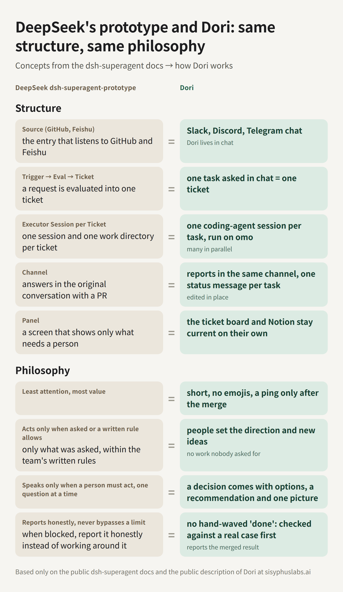

[English](README.md) · **简体中文** · [日本語](README.ja.md) · [한국어](README.ko.md)

<p align="center">
  
</p>

# win-dori

Dori 模式把一个编程智能体会话变成常驻的消息智能体。你只需要在 Telegram 或 Discord 上和一个机器人对话。Dori 把每件事交给 herdr 标签页里单独启动的智能体会话，记住自己启动过的每个会话，只有在工作真正完成后才关闭它:PR 已合并、issue 已关闭、版本已发布。

它由一个技能(`skills/dori-mode/SKILL.md` 和 references)以及一个用 bun + TypeScript 写的小 CLI `dori` 组成。目前还是实验版本，会有不完善的地方。

## 安装

### Windows

在 PowerShell 里，任意目录下一行即可。没有 git 时会用 winget 安装，没有 bun 和 herdr 时会用官方安装脚本安装(`DORI_NO_DEPS=1` 可关闭)。消息平台(Slack、Telegram、Discord 任选)和开机自启等 Windows 配置见[英文 README](README.md#windows-profile)。

```powershell
irm https://raw.githubusercontent.com/useonmn/win-dori/main/install.ps1 | iex
```

不管在哪里运行，都会装到 `%USERPROFILE%\.dori\src`,和 `install.sh` 使用 `~/.dori/src` 一样，所以不用先克隆或切换目录。再运行一次就会更新这份代码。技能会以目录联接(junction)的方式链接到 `%USERPROFILE%\.agents\skills\dori-mode`,所以不需要管理员权限，也不需要开发者模式。它会运行 `bun install` 和 `bun link`,如果 bun 的全局 bin 目录不在用户 PATH 里，就把它加进去。示例配置会复制到 `%USERPROFILE%\.dori\config.json`。这些位置可以用 `DORI_SRC`、`SKILLS_DIR`、`DORI_HOME` 修改，仓库可以用 `DORI_REPO` 修改。装完后新开一个终端,PATH 的改动才会生效。如果手上已经有一份代码,`.\install.ps1`(在 `cmd.exe` 里用 `install.cmd`)也一样。 再次运行时想跳过 `git pull`,和 `install.sh` 一样设置 `DORI_NO_PULL=1`(`true`、`yes` 也行),PowerShell 里写成 `$env:DORI_NO_PULL='1'`。

### macOS 和 Linux

```sh
curl -fsSL https://raw.githubusercontent.com/useonmn/win-dori/main/install.sh | bash
```

它会把仓库克隆到 `~/.dori/src`,把技能链接到 `~/.agents/skills/dori-mode`,用 `bun link` 把 `dori` 放进 PATH,并把示例配置复制到 `~/.dori/config.json`。如果你的智能体从别的目录加载技能，请设置 `SKILLS_DIR`。

然后在 herdr 里打开智能体，说一句 "Dori mode" 就行。

## 超级代理 harness

本仓库的根目录带着 [sisyphuslabs/dori-superagent](https://github.com/sisyphuslabs/dori-superagent) 的 harness，默认行为和功能都与上游一致，只改了 Windows 需要的部分。它是一个主动式、多会话的编程 Agent harness，跑在 [herdr](https://github.com/herdrdev/herdr) 和 [omo](https://github.com/code-yeongyu/oh-my-openagent) 之上，和 Dori 模式彼此独立。

和你对话的只有一个 lead 会话。每个任务是一条 lane：一个独立的 omo 会话，开在自己的 herdr 标签页里，从一份写好的任务简报（brief）启动，以一条必须附带证据的 READY 收尾。duty 循环负责催没动静的 lane、向 lead 上报，并把发给忙碌窗格（pane）的消息先存起来，等它能读了再送。合并要过一道门禁：精确 head 上的 CLEAR 评审回执，加上全绿的检查项。

两个 CLI 不要混淆：`dori` 是 Dori 模式，`dori-harness` 是这里的 harness，也可以用 `bun src/cli.ts` 运行。下文的命令都写作 `dori-harness`。harness 的状态在 `DORI_HOME`（默认 `~/.dori`）下，Dori 模式用同一文件夹里的 `state/` 和 `config.json`，两者不会互相覆盖；想分开，就把 `DORI_HOME` 指到别的文件夹。

### 缘起

DeepSeek 发布了 [dsh-superagent-prototype](https://github.com/deepseek-ai/dsh-superagent-prototype)（首次提交 2026-10-31），大约一天后又发了文章 "Exploring Super-agent Design: Towards a More Autonomous Agent System"。他们的设计是：一个长期存活的 Router 会话，只和人对话、只负责派活；彼此隔离的 Worker 会话，一个 ticket 一个；事件触发按轮次批量送达；外加一个 watchdog。他们的 README 把它定位为研究原型，写明的理念是 "take as little human attention as possible, and give as much value as possible"。

同样的结构，上游已经公开跑了大约六个月：

- 2026-04-18：团队模式合入 omo，多个 Agent 会话各占一个终端窗格，各带一个 worktree（[f1268c0](https://github.com/code-yeongyu/oh-my-openagent/commit/f1268c0)、[e303fee](https://github.com/code-yeongyu/oh-my-openagent/commit/e303fee)）。
- 2026-05-06：Dori 这个名字进入 omo 的 README（[#3807](https://github.com/code-yeongyu/oh-my-openagent/pull/3807)）。
- 2026-10-07：上游仓库以 `omo-dori-mode-experimental` 的名字发布 Dori 模式（[ce53e4d](https://github.com/sisyphuslabs/dori-superagent/commit/ce53e4d)）：一个 Agent 把每项工作交给 herdr 标签页里独立的 Agent 会话，活干完了才关掉它。git 历史是公开的。
- 2026-10-31：DeepSeek 原型的首次提交。
- 2026-11-01 前后：DeepSeek 的文章。

上游团队每天就是这么干活的。omo 有 70k+ star。从 2026-10-03 到 2026-11-02 的 31 天里，[作者的 GitHub 贡献日历](https://github.com/code-yeongyu)记录了 38,656 次贡献：平均每天约 1,250 次，峰值是 2026-10-16 的 2,227 次和 2026-10-29 的 2,001 次。也就是一天最多约 2,000 次贡献，全部出自这套方案的完整版。

仓库根目录的 harness 是它的最小版本：只保留光靠 herdr 和 omo 就能跑起来的那部分，其他什么都没接。

### 结构相同，理念相同

把 DeepSeek 原型的文档和 Dori 放在一起看，概念是一一对应的。结构对得上：



| DeepSeek dsh-superagent | Dori |
|---|---|
| Source（GitHub、Feishu） | Dori 就在聊天工具里：Slack、Discord、Telegram |
| Trigger -> Eval -> Ticket | 在聊天里提的一个任务，就是一张工单 |
| 每个 ticket 一个 Executor 会话（一个会话，一个工作目录） | 每个任务一个编程 Agent 会话，跑在 omo 上，多条并行 |
| Channel（在原来的对话里回复，比如带上 PR） | 在同一个频道里汇报，每个任务一条状态消息，原地编辑更新 |
| Panel（只展示需要人处理的事） | 工单看板和 Notion 自己保持最新 |

他们的[理念文档](https://github.com/deepseek-ai/dsh-superagent-prototype/blob/main/docs/000-philosophy.md)里的每一条也对得上：

| DeepSeek dsh-superagent | Dori |
|---|---|
| 占用人最少的注意力，交付最多的价值 | 消息短，不用表情，合并完成之后才 @ 人 |
| 只在有人要求、或团队的书面规则允许时才行动 | 方向和新想法由人来定；没人要求的活，Dori 不会自己开工 |
| 只在需要人出面时才开口，一次只问一个问题 | 每个决策都带着选项、Dori 自己的建议和一张图 |
| 如实汇报，从不绕过阻塞 | 没有证据不说“完成”；在真实案例上核对过，汇报的是已合并的结果 |

Dori 这一列是上游生产环境里的 Dori 和 Dori 模式（`skills/dori-mode`）；仓库根目录的 harness 在 herdr + omo 上实现了其中 lane、收件箱、duty 和合并门禁这一部分。

### 架构


三个角色，每个都是 herdr 窗格里的一个 omo 会话。herdr 提供工作区、标签页和窗格，能识别出窗格里跑的 omo 是一个 Agent，并通过 CLI 报告它的状态（idle、working、blocked、done）。dori 对任何窗格动手之前，先读这个状态。

lead 是唯一和你对话的会话。它把你的请求写成 brief，用 `dori-harness start` 开一条 lane，读 lane 发回来的东西，然后合并。

一条 lane 就是一个 omo 会话，开在自己的 herdr 标签页里，启动时拿到一份 brief，后面附着 lane 规则（`prompts/lane-footer.md`）。它用 `dori-harness report` 汇报阶段进展，用 `dori-harness ready` 收尾；`dori-harness ready` 没有证据链接就不会发出去。

duty 循环是 `dori-harness duty --interval 60`，一个普通进程，跑在 duty omo 会话旁边的窗格里。每一轮它把排队的消息送进已经空闲的窗格，催一下沉默太久的 lane，向 lead 上报，并把窗格已经消失的 lane 标记为 lost。`dori-harness duty stop --text "原因"` 是它的急停开关：在 `dori-harness duty resume` 之前，每一轮只打印 `DUTY stopped: <原因>`，跳过所有 duty 工作（不送消息、不催促、不上报、不记 duty 计数），排队的消息留在 inbox 里等着。`dori-harness duty status` 显示它是否停着以及原因。

状态是 `~/.dori`（或 `$DORI_HOME`）下的 JSON 文件：`lanes/`、`inbox/`、`briefs/`、`receipts/`，以及每小时循环用的 `backlog/` 和 `loop/`，还有 duty 循环放停止文件的 `duty/`。除了 Agent 会话，harness 新增的常驻进程只有 duty 循环和每小时循环两个，运行时依赖只有 Bun 一个。


`dori-harness start <key> --brief FILE` 把 brief 加上 lane 规则写到 `~/.dori/briefs/<key>.md`，开一个标签页，运行 `omo 'Read your brief at <path> and execute it. Your lane key is <key>.'`，把 lane 记为 `working`，再给 lead 发一条 `[START <key>]`。之后 lane 汇报进展（`[REPORT <key>]`；被自己窗格之外的事卡住时是 `[REPORT <key> WAITING]`），最后以 `[READY <key>]` 加证据链接收尾。lead 核对证据，有 PR 就跑 `dori-harness review` 和 `dori-harness merge`，再用 `dori-harness done <key>` 关掉这条 lane。一直空闲的 lane 会在 10 分钟和 20 分钟各被催一次，40 分钟时上报给 lead（`[ESCALATE <key>]`）。READY 之前窗格就没了的 lane，会被报告为 `[LOST <key>]`。

### 与 DeepSeek super-agent 的对应关系

| DeepSeek super-agent | dori | 在本仓库里 |
|---|---|---|
| Router 会话：和人对话，分派工作 | LEAD 会话：唯一和人对话的会话；开 lane，合并 | `prompts/lead.md`，`src/cli.ts` 里的 `up()` |
| Worker 会话，一个 ticket 一个 | LANE：每个任务一个 omo 会话，有自己的 herdr 标签页和自己的 brief | `src/harness.ts` 里的 `startLane()`，`prompts/lane-footer.md` |
| Ticket + Mandate | brief 文件 + lane 规则页脚，以及必须附带证据的 READY | `~/.dori/briefs/<key>.md`，`src/harness.ts` 里的 `ready()` |
| 触发器批处理：事件按轮次成批送达 | 窗格收件箱：发给忙碌窗格的消息先排队，等它空闲时合成一批送达 | `src/harness.ts` 里的 `send()`、`flushInbox()`；`src/store.ts` 里的 `inbox/` |
| Watchdog | DUTY 循环：清空收件箱，10/20 分钟催促，40 分钟上报，检测消失的窗格 | `src/harness.ts` 里的 `dutyTick()`，`prompts/duty.md`，`prompts/nudge.md` |
| 准入矩阵、`maxWorkers`（默认 3） | 每小时循环的预算：开着的 lane 最多 `--max-lanes`（默认 3）条，每轮最多 `--max-starts`（默认 2）条，主机负载高时不启动 | `src/loop.ts` 里的 `loopTick()` |
| 原型里没有 | 合并门禁：精确 head SHA 上的 CLEAR 评审回执，加全绿的检查项；空的检查列表永远不算绿 | `src/harness.ts` 里的 `review()`、`mergeGate()`，`prompts/review.md`，`src/store.ts` 里的 `receipts/` |
| 原型里没有 | 单一出口规则：lane 和 duty 从不直接和人说话 | `prompts/lead.md`，`prompts/duty.md`，`prompts/lane-footer.md` |
| 原型里没有 | 全文答案台账：每条 lane 的最终答案、证据链接和日志都落盘保存 | `src/store.ts` 里的 `Lane.final`、`Lane.log` |

### 快速开始

`install.ps1` 和 `install.sh` 已经把 `dori-harness` 链接好了，用它们装过的话可以跳过克隆这一步。手动安装需要 Bun 1.3 或更高版本、herdr、omo，以及 GitHub CLI `gh`（用来读 PR 的 head SHA、检查项状态，以及执行合并）。

```sh
git clone https://github.com/useonmn/win-dori
cd win-dori
bun install
bun link   # puts `dori-harness` on your PATH; or write `bun src/cli.ts` wherever it appears below
```

启动 herdr，然后在 shell 里：

```sh
dori-harness up
# UP lead=w1:p1 duty=w1:p2 loop=w1:p3 hourly=w1:p4 home=~/.dori
```

这会开一个名为 `dori` 的 herdr 工作区，里面有一个 lead 窗格（system prompt 末尾附加了 `prompts/lead.md` 的 omo）、一个 duty 窗格（附加了 `prompts/duty.md` 的 omo），下面是 duty 循环，再下面是每小时循环。和 lead 窗格对话即可。它会自己写 brief（目标、输入、交付物、停止条件、约束；见 [`examples/brief.md`](examples/brief.md)）并开 lane，你也可以在 shell 里手动做同样的事：

```sh
dori-harness start fix-flaky-login --brief examples/brief.md
# STARTED fix-flaky-login pane=w1:p5 brief=~/.dori/briefs/fix-flaky-login.md
dori-harness status
# lead=w1:p1 duty=w1:p2 home=~/.dori
# fix-flaky-login          working  w1:p5    active 0m ago  start: examples/brief.md
```

lane 的 key 要匹配 `^[a-z][a-z0-9-]{1,40}$`，已经开着的 key 会被拒绝。

在 lane 里，omo 用 lane 规则交给它的命令来汇报和收尾：

```sh
dori-harness report fix-flaky-login --text 'reproduced: 1 failure in 20 runs, shared session fixture'
dori-harness report fix-flaky-login --status waiting --text 'WAITING: checks on owner/repo#12'
dori-harness ready fix-flaky-login --text 'root cause fixed in owner/repo#12, checks green' --evidence https://github.com/owner/repo/pull/12
```

lead 收到 `[READY fix-flaky-login]` 之后：

```sh
dori-harness review owner/repo#12            # fresh omo reviewer pinned to the head SHA; writes a receipt; exit 0 on CLEAR
dori-harness merge owner/repo#12 --dry-run   # MERGE_OK ... (dry run), or MERGE_REFUSED <why> with exit 2
dori-harness merge owner/repo#12             # gh pr merge --squash --match-head-commit <sha>
dori-harness done fix-flaky-login            # closes the lane's pane; only a READY lane can be closed
```

`dori-harness send <lead|duty|key|pane> --text '...'` 把一条消息送到某个窗格，窗格忙的时候就排队。`dori-harness role <lead|duty> [PANE]` 用于没走 `dori-harness up` 时手动注册窗格。省略 `--text` 则从 stdin 读消息。Agent 看到的命令渲染时带着 `src/cli.ts` 的完整路径，并且设置了 `DORI_HOME`，所以它们的 PATH 上不需要有 `dori-harness`。环境变量：`DORI_HOME`（状态目录，默认 `~/.dori`）、`DORI_AGENT_CMD`（默认 `omo`）、`DORI_HERDR_SESSION`（具名的 herdr 会话）、`DORI_CMD`（告诉 Agent 怎么调用 harness）、`DORI_PANE_SHELL`（见下面的 Windows 说明）。

### Windows 窗格

herdr 新开的窗格可能是 pwsh、PowerShell 5.1、cmd 或 Git Bash，这四种 harness 都支持，端到端测试也都在真实 shell 里跑过。它会逐个探测窗格的 shell，并按该 shell 的规则加引号；想固定下来，就把 `DORI_PANE_SHELL` 设为 `posix`、`pwsh`、`powershell` 或 `cmd`。cmd 窗格里的 Agent 命令行实际由 PowerShell 5.1 解析，所以 `.ps1` 形式的 Agent 启动脚本会受执行策略限制。安装路径里有 `$`、反引号、`%` 或双引号时，请用 `DORI_CMD` 指定调用方式。

### harness 强制的规则

只有一个出口。lead 是唯一和你对话的会话（`prompts/lead.md`）。lane 规则要求，所有要给人看的事实一律发给 lead（`prompts/lane-footer.md` 第 3 条）；duty 会话从不合并，也从不和人说话（`prompts/duty.md`）。lane 做的每件事都以 prompt 的形式到达 lead 窗格：`[START]`、`[REPORT]`、`[READY]`、`[LOST]`、`[ESCALATE]`。

READY 必须带证据。没有至少一个 `--evidence` 链接，或者没有最终答案文本，`dori-harness ready` 就会拒绝（`src/harness.ts` 里的 `ready()`）。文本和链接作为 `final` 存在 lane 记录上；`dori-harness done` 拒绝任何状态不是 `ready` 的 lane，所以没有哪条 lane 能在没留下答案的情况下关闭。

忙碌的窗格不会被打断。`dori-harness send` 先向 herdr 查询窗格里 Agent 的状态。`idle` 或 `done` 立刻收到消息；其他状态下消息进入 `~/.dori/inbox/` 排队，命令打印 `QUEUED`。前台没有 Agent 在运行的窗格（Agent 已退出，shell(pwsh、powershell、cmd 或 bash)停在提示符；在 macOS 和 Linux 上也包括被 Ctrl+Z 挂起的 Agent）绝不会被输入文字，因为输入到 shell 的文字会被当作命令执行：发给它的消息留在队列里，duty 循环会打印 `inbox-held`，直到窗格里重新有 Agent。确实要往普通 shell 里输入时，由操作者加上 `--to-shell`：只对这一条消息生效，不会作用于队列里的消息。在 Windows 上 herdr 的 process-info 只列出窗格自己的 shell,所以那里由 herdr 的 Agent 状态来判断，`--to-shell` 也会逐行输入、每行单独按 Enter。等窗格空闲下来，duty 循环把队列合成一条消息送达，开头是 "N messages arrived while you were busy"（`src/harness.ts` 里的 `send()` 和 `flushInbox()`）。`dori-harness done` 也是同样的等法：herdr 报告为 working 或 blocked 的窗格，它拒绝关闭。

10 分钟、20 分钟催，40 分钟上报。`src/harness.ts` 里有 `NUDGE_MINUTES = [10, 20, 40]`。一条 lane 10 分钟没有汇报、窗格也不在 working，就会在自己的窗格里收到 `prompts/nudge.md`；20 分钟时再收一次；到 40 分钟，duty 循环不再催，改为给 lead 发 `[ESCALATE <key>]`。`working` 状态的窗格会重置空闲计时；汇报过 `--status waiting` 或窗格处于 `blocked` 的 lane 不会被打扰；任何一次新汇报都把催促次数清零；窗格消失则报告为 `[LOST <key>]`。

合并要有精确 head 上的 CLEAR 回执，检查项还得全绿。`dori-harness merge` 用 `gh` 读出 PR 的 head SHA，然后要求 `~/.dori/receipts/` 里存在该 SHA 的、结论为 `CLEAR` 的回执。能写回执的只有 `dori-harness review`。它拿固定在该 SHA 上的 `prompts/review.md` 起一个全新的非交互 omo（`omo -p --no-session`，可选 `--model`）；评审者没有打印 `VERDICT:` 行，就不写回执。接着 `gh pr checks` 必须返回至少一项检查，每一项都必须是 `pass` 或 `skipping`，并且至少有一项是 `pass`。空的检查列表会被拒绝，理由是 "an empty check list is never green"。合并本身是 `gh pr merge --squash --match-head-commit <sha>`。评审之后再 push 会改变 head SHA，回执就对不上了，合并随之被拒绝（`src/harness.ts` 里的 `review()` 和 `mergeGate()`）。

### 每小时循环

`dori-harness up` 还会在第四个窗格里启动 `dori-harness loop`。它每小时把 harness 的状态和实际情况对一遍，并自己开始下一项不需要任何人拍板的工作，lead 不必记着下一步该做什么。完整设计见 [`docs/hourly-loop.md`](docs/hourly-loop.md)。

工作排在 `~/.dori/backlog/` 的待办里，每项一个 brief。可以由 lead 添加，也可以导入带某个标签的、仍然开着的 GitHub issue：

```sh
dori-harness backlog add search-index --brief briefs/search.md --priority 2
dori-harness backlog add new-billing --brief briefs/billing.md --decision '按席位收费还是按工作区收费？'
dori-harness backlog import owner/repo --label dori     # p1..p9 标签设优先级，needs-decision 标签表示待决问题
dori-harness backlog list
```

每一轮先过一道关：循环被停掉、另一个循环持有锁、或者距上一轮不到一个间隔（默认一小时；`--force` 跳过这项检查），就什么也不做。过了这道关的一轮按顺序做五件事：

1. 同步。lane 已结束、或 READY 的 PR 已合并的项目标为 done。lane 丢失的项目回到队列，丢失两次就变成一个问题。导入的 issue 已关闭的项目被移除。
2. 漏办检查。3 小时没有汇报的 lane，READY 之后 2 小时没人关的 lane，窗格已经消失的 lane。
3. 拉取下一项。按优先级、再按先后，启动没有待决问题的开放项目（启动失败两次的项目会变成一个问题，不会挡住后面的项目）；开着的 lane 最多 `--max-lanes`（默认 3）条，每轮最多启动 `--max-starts`（默认 2）条。1 分钟负载高于核数（或 `--max-load`），或可用内存低于 10% 时（macOS 上只数空闲页总是接近 0，所以改用内核给出的可用内存水平；Windows 没有 1 分钟负载，这里用 CPU 使用率乘以核数再加处理器队列长度来代替），什么都不启动。
4. 提问。每个待决问题以 `[DECIDE <id>]` 发给 lead 一次，6 小时后最多再提醒一次。lead 去问人，再用 `dori-harness backlog decide <id> --text '...'` 记下答案（答案会追加到该项目的 brief 末尾），或用 `dori-harness backlog drop <id>` 移除该项目。
5. 汇报。一条 `[LOOP ...]` 消息发给 lead：开着的 lane 数与上限、待办计数、主机负载和可用内存，以及每一条发现。过关的每一轮也会记录在 `~/.dori/loop/runs/`。

除了它自己的状态文件（待办项目、运行记录、锁），循环只做两件事：开 lane、发消息。它从不合并、从不推送、从不关窗格，也不改开着的 lane 的记录（重试一个丢失的项目时，用同一个 key 开一条新 lane）；它调用 `gh` 只为读取。`dori-harness loop stop --text "原因"` 是急停开关：在 `dori-harness loop resume` 之前，每一轮都什么也不做。锁和上次运行的时间戳保证两个循环不会在同一个小时里重复跑，所以在窗格之外再用 cron 或任务计划程序跑 `dori-harness loop --once` 也是安全的。`dori-harness loop status` 显示最近一轮。

### 遥测

遥测默认开启。dori-harness 和 omo 用同一种方式发送匿名的使用计数：OTLP/HTTP JSON 日志，发到 omo 的收集端 `https://t.omo.dev`。身份标识是一个随机的安装 id，存在 `~/.dori/telemetry.json` 里，发出去的只有它的 sha256。第一次发送时，收集端用这个哈希给这次安装签发一把专属的 ingest key（`POST /v1/register`），key 缓存在 `~/.dori/telemetry.json` 里，收集端返回 401 时就重新签发。代码里不带任何共享 key。第一次运行会打印一行提示。设置 `DORI_TELEMETRY=0` 即可关闭（`DO_NOT_TRACK=1` 也行）；`DORI_TELEMETRY_ENDPOINT` 用来改写收集端的 URL。

| 事件 | 何时 | 字段 |
|---|---|---|
| `dori.installed` | 首次运行 | 无 |
| `dori.daily_active` | 任何 dori-harness 命令，每个 UTC 日一次 | `day_utc` |
| `dori.lane_started` | `dori-harness start` | `open_lanes` |
| `dori.lane_ready` | `dori-harness ready` | `evidence_count`、`lane_minutes` |
| `dori.review_completed` | `dori-harness review` | `verdict`：`CLEAR` 或 `BLOCK` |
| `dori.merge_decided` | 不带 `--dry-run` 的 `dori-harness merge` | `outcome`：`merged`、`no_receipt`、`review_block`、`no_checks`、`checks_red`、`checks_all_skipped` |
| `dori.duty_summary` | duty 循环，每小时最多一次 | `ticks`、`flushed`、`nudges`、`escalations`、`lost` |

日活、周活、月活就是从 `dori.daily_active` 算出来的。活跃数按安装计算，所以两个同时启动的运行偶尔多发一次，也不会改变数字。每条记录还带着资源字段：服务名和版本、安装哈希、CI 标志、操作系统类型（`darwin`、`linux` 或 `windows`；其他系统什么都不发）和版本、CPU 架构。永远不会发送的：路径、仓库名、PR 编号、lane 的 key、brief、消息，以及任何其他文本。发送在后台进行，每个请求超时 2 秒；命令退出前最多等它 2 秒，遥测失败也从不让命令失败。

### 这不是什么

一个最小实验，Windows 移植也没有改变这一点。harness 是 Bun 上的一小份 TypeScript，零运行时依赖，它不是上游的生产栈。有意不放进来的：跨机器的 mesh、heavy-slot 调度、聊天工具和工单系统的桥接，以及覆盖整个测试套件的回执。放进来的是光靠 herdr 和 omo 就能跑的部分：角色、lane、收件箱、duty 循环、每小时循环和待办，以及评审加合并门禁。`skills/dori-mode` 里的 Dori 模式是一个独立的 CLI，有自己的 IM 组件、主机守护和 heavy-slot 运行器；harness 不从它导入任何东西。

## 依赖

- [bun](https://bun.sh) 1.3 或更新版本，以及 git
- [herdr](https://herdr.dev):运行各条 lane 的终端复用器。Windows 上用 `powershell -ExecutionPolicy Bypass -c "irm https://herdr.dev/install.ps1 | iex"` 安装。
- 能加载技能的编程智能体(按 [OmO](https://github.com/code-yeongyu/oh-my-openagent) 设计，启动命令可以在配置里改)
- 用来确认 PR 合并和 issue 关闭的 `gh`(GitHub CLI),以及确认已发布版本的 `npm`
- 机器人本身用的 [agent-messenger](https://github.com/agent-messenger/agent-messenger)

主机监控在 macOS 和 Windows 上都会读取负载、内存、swap 和磁盘。Windows 上是通过一次 `powershell.exe` 调用读取的。那里的负载是 CPU 使用率乘以 CPU 数再加上处理器队列长度，取大约 1 秒的平均值，所以比 Unix 的 1 分钟平均波动更大。在 Linux 上只看负载和磁盘，内存和 swap 显示为未知。

## 给你的 Dori 起名

Dori 第一件事就是问你该怎么称呼它。直接叫 "Dori" 可以，用 Dori 结尾的名字也可以，比如 ShipDori 或 WorkDori,同时运行好几个时更好区分。定下的名字会用在机器人名、消息落款和模式名上，下次只要说一句 "ShipDori mode" 就能重新开启。

## 用 Slack 时

Windows 配置里的 Slack 监听器收到你的消息后，会先加一个 eyes 表情作为已读回执，并在线程里显示工作状态（默认"작업 중...",可用 `DORI_WORKING_STATUS` 修改），每分钟刷新一次，最长 30 分钟。Dori 回复后，状态清除，eyes 换成 white_check_mark。

如果你选 Slack,Dori 会再问一个问题，等你回答:

- **用户令牌**:作为工作区里的真实成员行动。需要一个付费席位，费用由你承担。这个成员能看到的它都能读，也能一直显示绿色在线点。
- **机器人令牌**:作为 Slack 应用行动。没有席位费用，但只能看到被邀请进的频道，并且受限于你给应用的权限范围。

## Dori 怎么说话

Dori 会跟着你的说话方式走。你写得简短、随意、用小写，它也这样回。无论用哪种语言，它都不用表情符号。一条回复有好几部分时，它会拆成几条短消息发，而不是一大段;每条准备好就立刻发，不故意停顿。唯一的例外是不断变化的进度：那始终是一条消息，原地修改。

## 配置

所有配置都在 `~/.dori/config.json` 里，每一项都可以省略。通常需要设置的是这些:

| 字段 | 含义 |
|---|---|
| `leadPane` | Dori 自己的 herdr pane(`herdr pane current`)。各条 lane 的汇报会发到这里。 |
| `laneWorkspace` | 新 lane 标签页打开的 herdr workspace |
| `defaultCwd` | lane 的起始目录，也是 lane 创建 worktree 的仓库 |
| `agentCommand` | 启动智能体的命令，写成含 `{model}` 和 `{prompt}` 的 argv 列表 |
| `paneShell` | lane pane 里的 shell:`auto`(默认)、`posix`、`pwsh`、`powershell` 或 `cmd`。`auto` 在非 Windows 上就是 posix;在 Windows 上会问 herdr 这个 pane 跑的是哪个 shell,问不到就当作 `pwsh`。如果你的 pane 总是用同一个 shell,就直接写明。 |
| `hooks.threadReply`, `hooks.threadDone` | 你的消息 CLI,写成含 `{thread}` 和 `{text}` 的 argv 列表，用来发布 lane 进度和标记完成 |

其余项(时间、阈值、heavy 槽位数)用默认值就够了。完整表格见 [`references/scripts.md`](skills/dori-mode/references/scripts.md)。环境变量 `DORI_CONFIG`、`DORI_STATE_DIR`、`DORI_LEAD_PANE` 优先于配置文件。

## 初次了解(Onboarding)

第一次设置时,Dori 在读取你的任何东西之前，会先征求同意：能不能了解一下你用哪些工具、在做什么、为什么做，以及你和你的公司是什么样的。只有你同意了，它才会一个一个地查看你的工具。每个工具它都会先说明要用哪个集成、会读取什么，再单独问你。比如:"有一个能读取 Gmail 和日历的 CLI,我想用它帮你留意日程和邮件，可以吗?"你拒绝的工具会被跳过，它也会记住你拒绝过。

整个过程只读不写。它边看边把了解到的内容写进记忆，最后简短地告诉你它了解了什么、还缺什么。完整流程见 [`references/onboarding.md`](skills/dori-mode/references/onboarding.md)。

## 怎么处理一个请求

每条消息怎么处理，由 Dori 自己决定。

- 提问、查状态、查资料，以及几次工具调用就能完成的小改动，直接处理，不开新会话。
- 最终要提交 PR 的代码工作、多步骤的工作、耗时长或可以并行的工作，开一条 lane。如果已经有一条空闲的 lane 负责这个仓库，就交给它，不再新开。
- 内存、磁盘或 pane 数量不够时(`dori can-launch` 显示 HOLD),不开新 lane。工作先排队，并告诉你原因。
- 新的工作开新的线程。后续的跟进回到原来的线程，如果那条 lane 已关闭，就重新打开记录下来的会话。简单的问题在哪里问的就在哪里答。

## 会话登记表

每条 lane 在 `~/.dori/state/lanes/` 下有一个 JSON 文件。它把消息线程对应到 herdr pane,把 pane 对应到智能体自己的会话 id,并记录状态(`working`、`done-claimed`、`verified-done`、`not-done`、`closed`)以及每次变化的历史。

`dori sync` 会把登记表和实际在运行的 pane 对照，告诉你哪里对不上：消失的 pane、变了的会话 id、没有办法证明已完成的 lane。它不会删除任何东西。加上 `--write` 会把找到的会话 id 存下来。

## 5 分钟完成流程

lane 声明自己已完成:

```sh
dori claim-done fix-login --evidence "merged acme/app#412 (a1b2c3d)"
```

Dori 收到 `LANE_DONE_CLAIMED`,lane 会被告知 5 分钟后关闭。这期间你可以提出异议:

```sh
dori object-done fix-login --reason "缺少 changelog 条目"
```

理由会原样发给 lane,lane 修好后再次声明完成。如果没人反对，时间一到 `dori watch` 就会关闭这条 lane。关闭前它会重新实时读取每个 `Done =` 信号；如果 worktree 里还有没推到远端的提交或未提交的改动，它就不关闭，声明会带着原因退回 not-done。重启 watcher 不会让 5 分钟重新计时。

### 怎样才算完成

lane 的 `Done =` 行写的是 watcher 能自己检查的信号:
- PR 已合并
- issue 已关闭
- 包的版本已发布
- 对于不以 PR 结束的工作(本地设置、QA、运行中的服务):退出码为 0 的命令、哈希或 JSON 字段符合预期的文件、返回预期状态码和内容的 URL

```
Done = command ["bun","test"]; file qa/report.json json:.passed=true; url http://localhost:3000/health body~"ready"
```

命令要写成 argv,比如 `["bun","test"]`,这样同一行在 Windows、macOS 和 Linux 上都能用。Windows 上像 `file C:\Users\ana\qa\report.json` 这样的路径会按原样读取，单个反斜杠就行。

关闭 lane 时,watcher 会自己重新运行这些检查，不经过 shell,也从不凭 lane 自己的说法就算数。无法解析的信号在启动 lane 时就会被拒绝。完整语法见 [`references/sessions.md`](skills/dori-mode/references/sessions.md)。

## 命令

| 命令 | 作用 |
|---|---|
| `dori launch <key> ...` | 在 brief 里写入 lane footer,打开标签页，启动智能体，检查启动错误 |
| `dori adopt <key> --pane ID ...` | 登记一条已经在运行的 lane |
| `dori sync [--write]` | 对照登记表和实际 pane,列出不一致 |
| `dori claim-done` / `object-done` / `close` | 完成流程 |
| `dori pause` / `resume` | 所有者说"等一下"时:不再提醒、暂停目标、停止正在运行的回合;以及恢复 |
| `dori watch` | 自动关闭的 watcher,作为常驻监控运行 |
| `dori freshness [--loop MIN]` | 提醒变安静的 lane,再把它最后一条汇报发到线程里 |
| `dori dead-panes [--loop MIN]` | 报告已停止的智能体 pane |
| `dori guard [--loop MIN]` | 负载、内存、磁盘和 pane 数量告警 |
| `dori heavy <label> -- <cmd>` | 只在有空闲槽位且负载低时运行构建或测试 |

发给 pane 的文字总是作为一个参数传入，从不经过 shell 字符串，并把每次发送报告为已送达或未确认。

## 实用工具

CLI 还带有 Dori 需要的消息相关功能，也可以作为 `scripts/src/messenger/` 下带类型的模块直接引用。

| 命令 | 作用 |
|---|---|
| `dori send slack\|telegram\|discord --to T --text X [--thread ID] [--edit ID]` | 发送或编辑消息。遇到限流会等待后重发，含有 `$(` 的文字会被拒绝 |
| `dori presence slack\|discord` | 让账号保持在线显示。Discord 机器人通过网关保持;Slack 用户账号通过每分钟发一次信号的网页客户端连接保持 |
| `dori transcribe <file>` | 用 `hooks.transcribe` 的命令把语音消息转成文字 |
| `dori can-launch` | 看看还有没有余量再开一条 lane |
| `dori inbound slack [--loop MIN]` | 不漏掉 Slack 上发给 Dori 的任何消息:Threads 视图里的未读回复、Dori 发过言的线程里的新回复(没 @ 也算)、有未读提及的私信和频道 |

没有对应命令、但模块里提供的功能:
- Telegram:以 "Thinking…" 开头的 `sendMessageDraft` 流式输出、论坛话题、HTML 表格
- Discord:创建线程、改名、归档
- Slack:上传文件
- `typingWhile`:工作进行时一直显示"正在输入"

Dori 在 Slack 上发的每条消息，不管是哪个函数发出的，都会记下所在线程。即使根消息是用原始 API 调用发的，下面没 @ 它的回复也能收到；只监听消息事件的做法会漏掉这种回复。

令牌从 `DORI_SLACK_TOKEN`(用户令牌还需要 `DORI_SLACK_COOKIE`)、`DORI_TELEGRAM_TOKEN` 和 `DORI_DISCORD_TOKEN` 读取。

## 测试

没有 CI,测试在本地运行:

```sh
cd skills/dori-mode/scripts
bun install
bun test           # 用假的 herdr、git、gh 验证行为
bunx tsc --noEmit  # 类型检查
```

在 Windows 的 PowerShell 里也用同样的命令。测试不会碰真实的 pane、仓库或 GitHub。

harness 的测试在仓库根目录用 `bun test ./test/` 运行,其中端到端测试会启动私有的 herdr 服务器,所以要设置 `DORI_TELEMETRY=0`。

## 许可证

MIT

## 从 OmOMeow 迁移

如果你之前用 gist 设置过 OmOMeow 模式，机器人照常能用。改下面四处，它就成了 Dori。

1. **起一个 Dori 名字。** 就叫 "Dori",或者用 Dori 结尾的名字，比如 ShipDori、WorkDori。对智能体说:"从现在起你叫 ShipDori,这是 ShipDori mode。"之后开启模式的说法就从 "OmOMeow mode" 换成 "ShipDori mode"。
2. **改机器人的名字和头像。**
   - Telegram:在 @BotFather 里发送 `/setname`,选中机器人，再发新名字。接着发送 `/setuserpic`,选中机器人，再发新图片。默认的 Dori 头像是 [`skills/dori-mode/assets/dori-avatar.png`](skills/dori-mode/assets/dori-avatar.png),也可以换成你喜欢的图片。机器人的名字和头像只能通过 BotFather 修改。
   - Discord:在 Developer Portal 打开你的应用。在 **Bot** 页面改用户名和图标，在 **General Information** 页面改应用名和图标(可以用同一张默认头像),然后保存。
3. **安装这个仓库。** 运行上面的一行安装命令，再对智能体说 "ShipDori mode",它就会用这个技能和 `dori` CLI,不再用以前粘贴的提示词。
4. **做一次初次了解。** 如果 OmOMeow 时期没做过，说一句"做一下 onboarding"就行。

原有的线程、话题和记忆都会保留。
